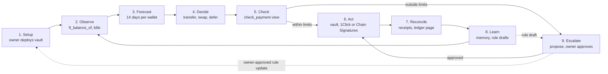

# Keel

Keel is an AI treasury agent that keeps a small company's stablecoin wallets funded. It can only move money inside limits enforced by a NEAR smart contract, the Keel Vault.

- **Who it is for:** a founder or lean finance lead with several wallets and chains and no treasury staff.
- **What it does:** reads balances and upcoming bills, forecasts 14 days ahead, and moves USDC to cover shortfalls. It pays alone under the cap and asks the owner above it.
- **What it cannot do:** spend past a cap, pay a blocklisted address, change its own rules or move NEAR. The vault refuses those calls, whatever the agent decides.

Built for NEAR HACKATHON (Nov 1–14, 2026). Tracks: Autonomous Business (`business`), AI Security & Defense (`security`), Real-World Money (`realworld`).

> Status: work in progress. Script names below are the planned ones and will be updated as the code lands.

## Try it in 10 minutes

Everything below runs on NEAR testnet and costs nothing.

**Fastest path:** run `cd agent && npm install && npm run demo -- --dry-run`. In a few seconds you see one full loop on `harbor.keel.testnet`: Keel reads the vault, forecasts 14 days, checks each bill's payee, and decides to pay Northwind, propose Atlas and payroll, and refuse the scam bill, with nothing signed. Once someone runs the demo for real, the vault pays each bill once, so later runs report those bills as already paid or proposed. To sign for real, prepare the vault once with `scripts/setup-demo-testnet.sh` and drop `--dry-run`; details in [agent/README.md](agent/README.md).

1. **Install.** Run `git clone https://github.com/Ultraviolet01/keel && cd keel && npm install`. You see the install finish with no errors.
2. **Configure.** Run `cp .env.example .env` and fill in an owner and an agent testnet account. You see both account ids printed by `npm run check-env`.
3. **Sign up as a founder in the app.** Run `cd web && npm install && npm run dev` and open the address it prints. You see the app blurred behind a **Connect wallet** panel. Connect a testnet wallet, name your company and click **Create vault**. You see your company's Overview with a setup checklist, Keel's agent connected and no limits. Click **Set limits** to choose your caps and payees. Without a wallet, open `/app?view=keel-owner.testnet` to see a founder's companies read-only. Details are in [web/README.md](web/README.md).

   **Or from the command line.** With your own testnet account, run `near contract call-function as-transaction keel.testnet create_vault json-args '{"name":"<company>"}' prepaid-gas '300 Tgas' attached-deposit '2.62 NEAR' sign-as <you>.testnet network-config testnet sign-with-legacy-keychain send`. You see `"<company>.keel.testnet"` returned: your company's own vault, owned by you, with Keel's agent key already on it and no policy. Both caps are 0 and the allowlist is empty, so every payment needs your approval. The deposit is the `min_vault_deposit` shown by `get_config` on `keel.testnet`; it pays the vault's storage and stays in the vault. Run it again with another name for each company you run; `get_vaults_for_owner` lists them all.
4. **Set your policy.** As the owner, call `update_policy` on your vault with your own caps and payees and 1 yoctoNEAR attached, for example `near contract call-function as-transaction <company>.keel.testnet update_policy json-args '{"update":{"per_payment_cap":"100000000","daily_cap":"500000000","allow":["<payee>.testnet"]},"reason":"initial policy"}' prepaid-gas '30 Tgas' attached-deposit '1 yoctoNEAR' sign-as <you>.testnet network-config testnet sign-with-legacy-keychain send`. You see `get_policy` return your values. The examples below assume 100 USDC per payment and 500 per day.
5. **Pay under the cap.** Run `npm run agent -- --once`. You see Keel pay Northwind Hosting 80 USDC alone, with a transaction hash and the rule it checked.
6. **Go over the cap.** Run `npm run scenario:shortfall`. You see Keel file proposal #1 to move 8,000 USDC to Payroll, with its reasons. The vault has moved nothing yet.
7. **Approve as owner.** Run `npm run approve -- 1`. You see the owner's key sign `approve(1)` and the move execute.
8. **Try the attack.** Run `npm run attack`. You see two refusals in the log: the counterparty check, then the vault.
9. **Pull the kill switch.** Run `npm run pause`, then repeat step 5. You see the vault refuse the payment until `npm run resume`.

**Export for your accountant:** run `npm run export -- --csv`, or click Export CSV on the Activity page. You see `ledger.csv` with one row per move: date (UTC), from wallet, to, amount, token, chain, fee, status (paid, pending, refunded, refused), rule checked, approved by and transaction link.

## How it works

A move within limits goes straight from Check to Act; anything over the threshold becomes a proposal. Blocked moves stop at Check and are logged, never proposed. Stages 2 to 8 repeat every few minutes.

## Keel Vault contract

The vault holds the USDC and the rules, and decides every payment's band itself. It deploys with no policy; the owner chooses every limit. The agent's key can call only two methods.

| Method | Who can call it | What it does |
| --- | --- | --- |
| `execute_payment` | Agent key | Pays an allowlisted payee if the amount is within the per-payment and daily caps, and the bill (`bill_ref`) was not paid before |
| `propose_payment` | Agent key | Files a proposal for anything over the threshold, a new payee or a cross-chain swap. A newer proposal for the same bill replaces the waiting one |
| `bill_paid_at` | Anyone (view) | When the vault paid a bill, or `null` |
| `pending_count` | Anyone (view) | How many proposals wait for the owner; at most 50 |
| `release_bill` | Owner key | Lets a bill be paid again, after the owner confirms a payment never arrived |
| `check_payment` | Anyone (view) | Returns the band a payment would land in, without moving money |
| `approve` / `reject` | Owner key | Executes or closes a proposal |
| `update_policy` | Owner key | Changes caps, allowlist, blocklist or threshold, and logs old value, new value and reason |
| `pause` / `resume` | Owner key | Stops every payment at once, then restarts them |
| `withdraw` | Owner key | Pays out directly, for example back to the owner; works while paused |
| `set_evm_route` / `withdraw_evm` | Owner key | Sets or turns off the Base chain, token and fee caps for Chain Signatures payments; moves funds out of the vault's Base address |
| `get_evm_route` | Anyone (view) | The vault's EVM route and the inputs that derive its Base address |

| Band | Rule (USDC) | Result |
| --- | --- | --- |
| Runs alone | Allowlisted payee, within the owner's per-payment and daily caps (example: 100 and 500) | Vault pays, Keel logs and reconciles |
| Needs approval | Over 100, a new payee, or any cross-chain swap | Proposal waits for the owner |
| Blocked | Blocklisted payee, vault paused, or daily cap reached | Vault refuses; Keel logs it and alerts the owner |

Two token details the vault handles itself: it attaches the 1 yoctoNEAR that `ft_transfer` requires, because a function-call key cannot attach a deposit, and it registers new payees with `storage_deposit` before paying them.

Owner methods require exactly 1 yoctoNEAR attached. Function-call keys cannot attach a deposit, so only the owner's full-access key can approve, change the policy or pause.

**Check the rules yourself:** run `cd contract && cargo test`. You see 68 tests pass, one per rule, including `refuses_payment_over_cap`, `refuses_blocklisted_payee`, `agent_cannot_change_policy`, `revoked_agent_can_do_nothing`, `pause_blocks_everything_until_resume`, `evm_bill_with_a_huge_fee_is_refused`, `signing_hash_matches_an_independent_encoder`, `agent_cannot_pay_the_same_bill_twice`, `a_failed_transfer_frees_the_bill_to_be_paid_again`, `at_most_50_proposals_wait_at_once` and `owner_can_still_act_when_the_vault_is_low_on_near`. Method details are in [contract/README.md](contract/README.md). For the factory, run `cd factory && cargo test`: 15 tests.

## Security

**Each bill is paid once, enforced by the vault.** Keel tags every payment and proposal with the bill's id. The vault records each bill it pays and refuses a second payment (`Keel Vault refused: this bill was already paid`), even if the agent restarts with no memory or is tricked into retrying. A failed transfer frees the bill again. At startup Keel reads `bill_paid_at` and the vault's proposals, so a lost `agent/state.json` never causes a double payment.

1. Run `cd agent && rm -f state.json && npm run agent -- --once --vault orbit.keel.testnet`. You see `the vault already paid this bill` for Northwind and `already proposed as #1` for Atlas, and nothing is signed.

The agent never holds a key that can move money freely. Limits live in the contract, so a compromised or prompt-injected agent still cannot overspend.

- **Agent key on the vault, added at sign-up:** the factory adds Keel's agent key to each new vault account in the same transaction that creates it. It is a NEAR function-call access key limited to that vault's `execute_payment` and `propose_payment`, with a 0.25 NEAR gas allowance. It cannot transfer NEAR, add keys, call `update_policy` or touch any other vault. The vault also checks that the agent key signed the call.
- **No other keys:** the vault account has no full-access key, so nobody, Keel included, can sign as the vault to move money around its rules.
- **The founder can fire the agent:** `revoke_agent` deletes the key from the vault in one transaction; `set_agent_key` adds a new one. Both need the owner's full-access key.
- **Owner key:** the founder's own wallet. Keel never holds it, and it is never stored in this repository.
- **Gas:** the agent's gas comes from the vault's own deposit, not from Keel.
- **Rule changes:** every `update_policy` call writes old value, new value, reason and approver to the public ledger page.

**Counterparty check:** before any payment, Keel scores the receiver and returns a verdict with its reasons.

| Verdict | What Keel does |
| --- | --- |
| Allow | Continues to the vault's own band check |
| Warn | Never pays alone; files a proposal with the reasons for the owner |
| Block | Refuses to sign and logs the reasons |

| Signal | Source |
| --- | --- |
| Account age and activity | Account's first transaction and recent transaction count from an RPC or indexer |
| Receiver is a contract, and its code changed recently | `view_account` code hash, compared with the last hash Keel saw |
| Prior payments from this vault | Keel's own ledger |
| Blocklist | Vault blocklist, set by the owner |

**Stolen agent key cannot flood the vault.** At most 50 proposals wait at once, a newer proposal for the same bill deletes the old one, and the agent's calls are refused once the vault's spare NEAR would fall under 0.2 (`the vault is low on NEAR for storage`). The owner can always still approve, pause, withdraw and revoke the agent.

**Stress tests (run them yourself on a throwaway vault).**

1. Run `cd agent && STRESS_VAULT=<your vault> STRESS_OWNER=<its owner> npm run stress`. It signs as the agent key, the owner and an outsider and tries 52 attacks: owner methods with the agent key, private callbacks, blocklisted, new and over-cap payees, zero, negative and u128::MAX amounts, oversized text, the daily cap over many payments, 4 parallel payments of one bill, double approval, expired and superseded offers, 7 malformed EVM transfers, pause and revoke. You see `52 passed, 0 failed` (run on `stress2.keel.testnet`, Nov 2).
2. Run `npm run stress:flood -- 80`. It files maximum-size proposals with the agent key until the vault refuses. You see it stop at the storage reserve after about 35 proposals, then the owner's withdraw and pause still succeed.
3. Run `npm test`. Besides the unit tests, about 37,000 generated cases check that Keel never chooses to pay while paused, to a warned or blocked payee, on a spike, beyond the balance, or outside the vault's own band, and that bad amounts like `-5` or `1e3` in `config/bills.json` are rejected.

Also checked by hand on testnet: two agents running at once paid a bill once; with the NEAR RPC or the Base RPC unreachable, the agent logs one line and retries; the factory refuses bad names, a taken name, too small a deposit and non-admin code changes, and a vault creation that runs out of gas reverts fully (the founder loses only the 0.002 NEAR fee).

**Attack demo (`npm run attack`):**

1. A prompt-injected bill tells Keel to pay a blocklisted address.
2. Keel's counterparty check flags the address and refuses. You see refusal one in the log.
3. The script then forces the call to `execute_payment` anyway. You see the vault reject the transaction on chain, with its receipt as refusal two.

## Live on testnet

Deployed on Nov 2, 2026 with `scripts/deploy-factory-testnet.sh`. Anyone can read these, for example `near contract call-function as-read-only keel.testnet get_config json-args {} network-config testnet now`.

| Account | What it is |
| --- | --- |
| `keel.testnet` | Keel factory: creates a vault for each company a founder adds (up to 20 per founder) |
| `nova.keel.testnet` | A company vault owned by `keel-owner.testnet`, with Keel's agent key `ed25519:GZ1zQGxc…` added by the factory at sign-up; no policy set |
| `kora.keel.testnet`, `lumen.keel.testnet` | Earlier vaults for the same founder, from before the agent key moved onto the vault; they use the separate agent account `agent.keel.testnet` |
| `harbor.keel.testnet` | The demo vault for `npm run demo`, owned by `keel-owner.testnet`, created with the current code (once-per-bill rule and flood limits) |
| `orbit.keel.testnet` | The earlier demo vault, used for the memory-loss test below |
| `vega.keel.testnet` | A vault created with the Chain Signatures code, owned by `vega-founder.testnet`. Its Base Sepolia address is `0x69aa0eb2153c0fed2cd3b44f418f50a02a3cffed` |
| `usdc.keel-owner.testnet` | Keel Test USDC |

Checked live:

1. **Founder signs up, agent connected automatically.** `keel-owner.testnet` called `create_vault` with `"nova"` ([transaction](https://explorer.testnet.near.org/transactions/7uK1gfQUHUbyL8e3n7KWojtNdTmpgxAQtWdMGzhV2ETw)). With no script run, `near account list-keys nova.keel.testnet network-config testnet now` shows one key: `only do ["execute_payment", "propose_payment"] function calls on nova.keel.testnet with an allowance of 0.25 NEAR`.
2. **The agent works inside the rules.** Signing with that key, the agent's payment is refused (`Keel Vault refused: new payee, not on the allowlist`), its proposal is accepted as `1`, and its `update_policy` call is rejected by the network (`isn't allowed by the access key`).
3. **The founder fires and rehires the agent.** `revoke_agent` deleted the key ([transaction](https://explorer.testnet.near.org/transactions/2pFH9SePN6REQ172fZbzRFcsiB1tvp5rFagV9PigENC5)) and the agent's next call failed with `Access key ... does not exist`. `set_agent_key` added it back ([transaction](https://explorer.testnet.near.org/transactions/3XJqZ1wSxaxEMn5dd1mvfNYTmMT83uefCfvBzM2K6Vhy)) and the agent's next proposal was accepted as `2`.
4. **Earlier sign-up.** `keel-owner.testnet` called `create_vault` with `"kora"`. You see `"kora.keel.testnet"` returned and a `vault_created` event ([transaction](https://explorer.testnet.near.org/transactions/GLV4QR6FwuZeTSPWWHrEvZxdsFky4dGVTNKx5H69W4Fy)).
5. **One founder, several companies.** The same founder added `"lumen"` ([transaction](https://explorer.testnet.near.org/transactions/QX7P8RhhbXG1AbMo87KQNvE2hn6QUEGqRhen6L6bud2)). You see `get_vaults_for_owner` on `keel.testnet` return all three: `kora`, `lumen` and `nova`. Each vault has its own money, policy and agent key.
7. **The agent runs the demo.** After `scripts/setup-demo-testnet.sh` (Nova's policy: 100 per payment, 500 per day, Northwind and Payroll allowed, the scam account blocked; 1,000 test USDC), `npm run demo` took 9.6 s: it paid Northwind Hosting 80 alone ([transaction](https://testnet.nearblocks.io/txns/Da5R9fRbMDYnRoVeyadGMD4ikgFUY8fQZir93Lb6ZQyS)), proposed Atlas Freight 132 as #3 because Atlas is not allowlisted ([transaction](https://testnet.nearblocks.io/txns/7vdd1dT2t3cWxUUBxSPCyG74aHwt9Q6LVp7NGupWVs2f)), refused the "URGENT: supplier changed bank details" bill without signing because the payee is blocklisted, and proposed Contractor payroll 450 as #4 because it is over the cap ([transaction](https://testnet.nearblocks.io/txns/5pi9j2RtGvjn2vcUx712ytgJGkrSZyRRKeHCfosCpCS2)). `ft_balance_of` shows `northwind-keel.testnet` holding 80 and the vault 920.
8. **Paying on Base without 1Click.** The agent proposed a 1 USDC transfer on Base Sepolia from `vega.keel.testnet` as #1 ([transaction](https://testnet.nearblocks.io/txns/FjjJnVwJfmc7GmDvPXxEToZqJNj3zf4NhMXcw96Ug7ue)). The founder approved it ([transaction](https://testnet.nearblocks.io/txns/CwtmxfryUoEoCwKUAUHETVx6fKmYkU3fNZHzsUDxM2Bp)). The vault built the transfer, `v1.signer-prod.testnet` signed it, and the vault stored it with an `evm_signed` event. Recovering the signer from the stored transaction with viem gives `0x69aa…cffed`, the vault's own address. Once the address was funded, Keel broadcast it and it landed on Base Sepolia ([transaction](https://sepolia.basescan.org/tx/0x810f796b040edca5df3b1c3c3097d2dc31f5f060bf06e5436166b300f3b29171)).
9. **A Base bill paid end to end.** For the 15 USDC "Designer invoice, paid in USDC on Base" bill in `config/bills.json`, Keel skipped 1Click (mainnet only), proposed a Chain Signatures transfer as #4, the founder approved it ([transaction](https://testnet.nearblocks.io/txns/EyRxbDQyv4MocVD1DwhWkrgMZuWufrbRJFRxXjmHMK1V)), and Keel broadcast the vault-signed transfer ([transaction](https://sepolia.basescan.org/tx/0xb39efe2b80d77ced7be0bb619055c957b4271fbf490cc7a8bdd1a894a64aa1d3)). The vault's Base address went from 20 to 4 USDC. An earlier proposal, #3, had taken a nonce that #1 then used; Keel flagged it as unable to land and proposed #4 instead.
10. **No double payment after memory loss.** On `orbit.keel.testnet`, `npm run demo` paid Northwind 80 ([transaction](https://testnet.nearblocks.io/txns/3vcwJbZebqFq8DueC2HP1W5qsrdFwt8NgbDm5tRAD7B9)) and proposed Atlas (#1) and payroll (#2). After deleting `agent/state.json`, the next run reported Northwind paid and Atlas proposed, and signed nothing. Calling `execute_payment` for the same bill directly with the agent key failed on chain with `Keel Vault refused: this bill was already paid`; the vault's balance stayed at 920.
6. **Same code everywhere.** `get_config` on `keel.testnet` shows `vault_code_hash` `F3mdCiykAp1nYnj1aJGbRDMeP6r4XBQAhEFbhX2sXhZP`, the base58 SHA-256 of `contract/target/near/keel_vault.wasm` built from this repository at this commit.

## Cross-chain bills

Keel has two independent routes for a bill on Base, so one service going down does not stop the bill:

| Route | Depends on | Testnet |
| --- | --- | --- |
| 1. NEAR Intents 1Click | Defuse's 1Click API | No, mainnet only |
| 2. NEAR Chain Signatures | NEAR validators only (MPC network) | Yes, Base Sepolia |

Keel tries 1Click first and falls back to Chain Signatures. If neither works, the bill waits and Keel tries again on the next run. Details and a dry run are in [agent/README.md](agent/README.md#cross-chain-bills-two-routes).

**Chain Signatures route.** Each vault controls one address on Base, derived from its own account by NEAR's MPC contract. The vault signs only one thing: a USDC `transfer` on the owner's chosen chain, with gas and fees under the owner's caps (100,000 gas, 5 gwei). It builds and hashes the transaction itself, so the agent cannot get anything else signed. Signing waits for the owner's approval, and blocklisted 0x addresses are refused. Approving needs 300 Tgas, because the vault waits for the MPC signature.

### Mainnet Intents leg

NEAR Intents has no testnet, so cross-chain moves run on mainnet through a second Keel Vault capped at a 5 USDC budget. On testnet, the shortfall scenario in Try it uses a dry quote instead.

1. **List tokens.** Keel calls 1Click's token list. You see USDC on NEAR and on the target chain.
2. **Dry quote.** Keel requests a quote without a deposit address. You see the expected output and fee in the proposal.
3. **Real quote after approval.** Once the owner approves, Keel requests a real quote. You see a deposit address valid for about 10 minutes.
4. **Fund through the vault.** Keel funds that address through the vault at once. You see the vault's transaction hash.
5. **Poll status.** Keel polls `/v0/status` until the swap is final. You see `SUCCESS`, `FAILED` or `REFUNDED` on the ledger page, with the 1Click id.

**Fees:** requests without a partner JWT pay an extra 0.2%. Set `ONECLICK_JWT` in `.env` to remove it.

**Verify it yourself:** open the mainnet vault's transactions in a NEAR explorer and match each one to its ledger row.

## NEAR tools used

- NEAR smart contract (Keel Vault)
- Function-call access keys (scoped agent key)
- NEAR Intents 1Click API (cross-chain moves)
- NEAR Chain Signatures (each vault's own Base address, the fallback route when 1Click is down)
- NEAR AI Cloud (optional, writes the wording of a proposal's reason; decisions stay in plain code)

## Repo layout and configuration

| Path | What it holds |
| --- | --- |
| `contract/` | Keel Vault smart contract and its tests |
| `factory/` | Keel factory: one vault per company, created when a founder signs up or adds a company |
| `agent/` | The agent service: observe, forecast, check, decide, act, learn, for every vault on the factory |
| `config/bills.json` | Bills Keel watches for each vault (due dates can be relative, like `+2`) |
| `config/treasury.json` | Wallets, minimums, payees and upcoming bills |
| `scripts/` | `deploy-factory-testnet.sh`, `new-agent-key.mjs` (Keel's agent keypair), and the planned demo scripts |
| `web/` | The app: wallet sign-in, one vault per company, company switcher and Overview (Vite, React, TypeScript, NEAR Connect) |
| `test-token/` | Keel Test USDC, a NEP-141 token with 6 decimals for testnet only |

| `.env` variable | Purpose |
| --- | --- |
| `NEAR_NETWORK` | `testnet` or `mainnet` |
| `FACTORY_ACCOUNT_ID` | Keel factory, `keel.testnet` on testnet |
| `AGENT_KEY_FILE` | Path to Keel's agent key file from `scripts/new-agent-key.mjs`, outside the repository |
| `USDC_CONTRACT_ID` | USDC token contract on the chosen network |
| `ONECLICK_JWT` | Optional partner token; removes the 0.2% fee |
| `EVM_RPC_84532`, `EVM_RPC_8453` | Optional RPC URLs for Base Sepolia and Base; defaults are the public endpoints |

The owner's private key is never put in `.env`. Owner actions sign through the NEAR CLI or a wallet.

## Limits and known issues

- **Mainnet budget:** the Intents leg moves at most 5 USDC. Dashboard figures such as 48,215.40 USDC are sample data.
- **Forecast inputs:** bills and invoices come from `config/treasury.json`, not from an accounting system.
- **Learning is rule-based:** Keel drafts a cap change after 3 approvals in a row for one payee, and flags any bill more than 25% above that payee's last 3. It never changes a limit itself.
- **Counterparty check:** on-chain signals and the vault blocklist only; no external risk scoring.
- **Base address funding:** the vault's Base address needs its own USDC and a little ETH for gas. Keel says how much is missing; it does not top the address up itself. Testnet funds come from Base Sepolia faucets.
- **Signed means sendable:** once the MPC network signs an approved transfer, anyone can broadcast it, not only Keel. Keel broadcasts it on its next run. EVM transfers land in nonce order, so if the owner approves them out of order, the later one waits.
- **Older vaults:** each vault keeps the code it was created with. `nova`, `kora`, `lumen` and `vega` predate the once-per-bill rule; `orbit` and `stress` predate the flood limits. `harbor` and `stress2` have everything. Vaults created now get all of it (`vault_code_hash` `F3mdCiykAp1nYnj1aJGbRDMeP6r4XBQAhEFbhX2sXhZP`).
- **Agent key allowance:** the factory gives the agent key 0.25 NEAR for gas, about 650 actions at testnet prices. The owner renews it with `set_agent_key`.
- **Single owner:** one full-access key approves everything; multisig approval is not built.

## Libraries and AI-generated code

- [near-sdk 5.30](https://crates.io/crates/near-sdk) and [near-contract-standards 5.30](https://crates.io/crates/near-contract-standards) for the contracts
- [cargo-near 0.22](https://crates.io/crates/cargo-near) to build them, [near-cli-rs 0.30](https://www.npmjs.com/package/near-cli-rs) to deploy and call them
- [near-api-js 7.3](https://www.npmjs.com/package/near-api-js) for the agent's signing, run with [tsx](https://www.npmjs.com/package/tsx); optional [NEAR AI Cloud](https://cloud.near.ai) for proposal wording
- [viem 2.57](https://viem.sh) for the agent's Base reads and broadcasts; [@noble/hashes 1.8](https://www.npmjs.com/package/@noble/hashes) for keccak in the app (deriving the vault's Base address)
- [NEAR Connect 0.11](https://www.npmjs.com/package/@hot-labs/near-connect) for wallet sign-in, with [React 19](https://react.dev), [Vite 8](https://vite.dev) and TypeScript 5.9 for the app

Parts of this project are written with AI coding agents (Claude Code).

## License

MIT, see [LICENSE](LICENSE).
