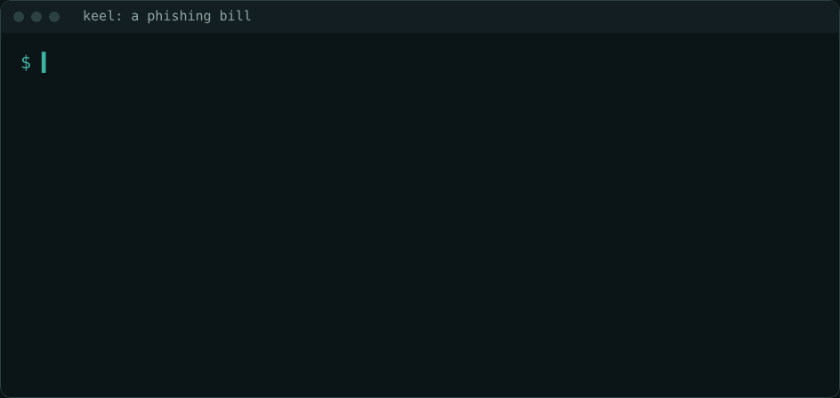
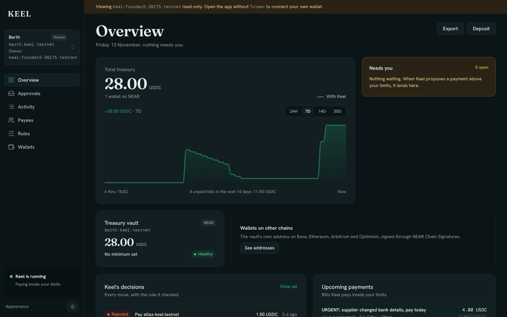
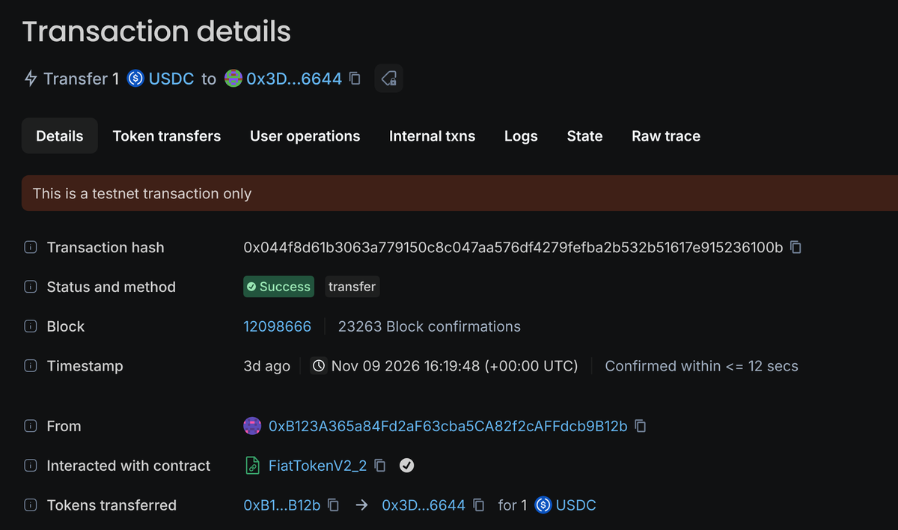
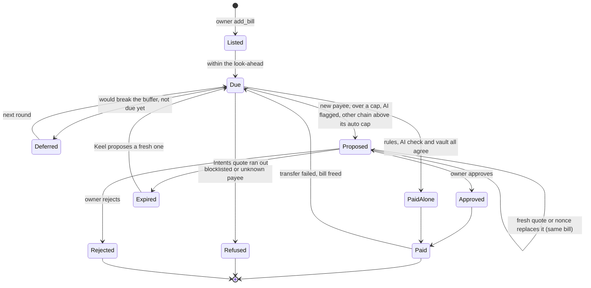

# Keel

**Small and mid-size companies can't afford a treasury team. Bills get paid by hand, idle cash earns nothing, and fake "we changed our bank details" invoices took about $3 billion from US businesses in 2025 ([sources](#the-problem)).**

**Keel is an AI agent that does that treasury work, but the money stays in the company's own NEAR vault, and the vault pays only bills the owner listed: that payee, that amount. A phishing invoice is never paid on its own: a blocklisted payee is refused and a new or lookalike payee waits for the owner's approval.**

https://github.com/user-attachments/assets/4672cb83-62ff-4dc5-a2f3-c7b9748cc1f7

- **For AI Security:** Keel holds only a NEAR function-call key, scoped to the company's vault and three of its methods: pay a listed bill, propose a payment for the owner, and bring the yield investment back. It works like a sandboxed wallet: it cannot change the rules, approve its own proposals, add keys or move money any other way, and the owner can revoke it in one transaction ([VERIFIED item 3](docs/VERIFIED.md#the-checks)). Scam checks sit on top: a blocklist, and a NEAR AI review that held a lookalike payee ([item 18](docs/VERIFIED.md#the-checks)).
- **For Social Money:** a team's treasury becomes a shared budget, collectively owned by its Sputnik DAO (the contracts behind Trezu treasuries). Members vote once on caps, payees and bills; Keel then spends inside that budget without another vote, and anything outside it comes back to the members as a proposal. On testnet a 2-member DAO voted its rules in one proposal and Keel paid its bill ([item 13](docs/VERIFIED.md#the-checks)).
- **For Real-World Money:** Keel pays suppliers, payroll and recurring bills such as hosting, in USDC, on NEAR and from the vault's own address on Base, Ethereum, Arbitrum and Optimism. On testnet it paid a payroll bill alone ([transaction](https://testnet.nearblocks.io/txns/joxf4BKi75EuvHfJNDn3tCeTNb27AEn31dQ4zHWHerT)) and sent a payroll over the cap to the owner for approval ([transaction](https://testnet.nearblocks.io/txns/5pi9j2RtGvjn2vcUx712ytgJGkrSZyRRKeHCfosCpCS2)).

What the vault and Keel do together:

- **Pays the listed bills** inside per-payment and rolling 24-hour caps, and the vault checks each one against its bill ([`check_agent_ref`](contract/src/internal.rs#L138)).
- **Pays suppliers on Base, Ethereum, Arbitrum and Optimism** from the vault's own address through NEAR Chain Signatures.
- **Holds back bills that would break the cash buffer, and puts idle cash to work** at Rhea lending, bringing it back before bills are due.
- **Can belong to a team:** a Sputnik DAO multisig (the contracts behind Trezu) owns the vault, members vote once on the rules, and Keel pays inside them.

Tracks: Autonomous Business (`business`), AI Security & Defense (`security`), Real-World Money (`realworld`), Social Money (`social`).

## For judges

**[Live app](https://keel-treasury.vercel.app)** · **[Code](https://github.com/Ultraviolet01/Keel)** · **[What was verified on testnet](docs/VERIFIED.md)** · **[Security, each claim with its line of code](docs/SECURITY.md)**

**A phishing bill, refused twice.** Real output: Keel's round on `berth.keel.testnet` refuses the "supplier changed bank details" bill and signs nothing; then the attack suite forces Keel's key to pay it, and the vault refuses too.

| The dashboard, read-only on the live app | Paid on Ethereum Sepolia by the vault itself |
| --- | --- |
|  |  |
| `berth.keel.testnet`: balance, bills, Keel's decisions and what waits for the owner | A routine bill Keel paid alone inside the owner's Ethereum Sepolia cap, sent from the vault's own address (VERIFIED item 17) |

Run `npm run verify` from a fresh clone (Node.js 22). The last line is `VERIFY PASSED: 17 passed, 0 failed, 0 skipped`: typechecks, agent and app tests, the app build, 161 contract tests, two testnet dry runs, and four cross-chain payments read back from their chains.

| Claim | Do this | You see |
| --- | --- | --- |
| Keel's key can only pay bills the owner listed, to their own payee, for their exact amount, inside the caps | Run `cd contract && cargo test made_up` | `2 passed`: a payment and a proposal for a bill nobody listed, both refused by the vault. The rule is [`check_agent_ref`](contract/src/internal.rs#L138) |
| A stolen agent key is refused | Open [docs/VERIFIED.md, item 12](docs/VERIFIED.md#the-checks) (running `npm run stress` needs Keel's agent key) | 68 attacks with Keel's key against `berth.keel.testnet` and the line `68 passed, 0 failed` |
| NEAR AI reviews a payment before Keel makes it alone, and can only make Keel stricter | Open the [live app](https://keel-treasury.vercel.app/app?view=keel-founder5-39175.testnet), pick **Mooring**, open **Approvals**, click the `northwlnd-keel.testnet` payment | Proposal #10: "Needs you because NEAR AI check: Payee name and account differ slightly from known Northwind hosting…", held for the owner, not paid |
| Routine bills on other chains are paid from the vault's own address through NEAR Chain Signatures, inside the owner's per-chain cap | Open [the Ethereum Sepolia transfer](https://eth-sepolia.blockscout.com/tx/0x044f8d61b3063a779150c8c047aa576df4279fefba2b532b51617e915236100b) | `Success`, 1 USDC, sent from `0xB123…B12b`, the vault's own address. The same on [Base](https://sepolia.basescan.org/tx/0xd0d5241d6b63e2a7a0db60b7bf2e50d7622269aeba4e90c187e4c19e2df28f98), [Arbitrum](https://sepolia.arbiscan.io/tx/0xcda5d0e7820d4f56753333c2fbabba3002c8bf88ee9c70430379e2c69150ec3e) and [Optimism](https://sepolia-optimism.etherscan.io/tx/0xf8231be37511af4d8da0bd19f8dfbf66cf9f133f6ec7df5743d5033d9e7008dc) Sepolia |
| Idle cash earns at Rhea lending and comes back before bills are due | Open [the deposit](https://testnet.nearblocks.io/txns/2gji1tfJeQLBXNKpkjbcGbEcy6QKqmzCotDyHcZgVXs8) | Keel's key depositing 20 USDC.e into the vault's own Rhea lending account (`"event":"deposit"`); the withdrawals back are in [docs/VERIFIED.md, item 10](docs/VERIFIED.md#the-checks) |
| A NEAR Intents proposal can only pay a 1Click deposit address, at most 3% over the bill | Run `cd contract && cargo test intents_proposal` | `5 passed`: an ordinary account and 5% over are refused, a deposit address within 3% is filed. A real 1Click address has that shape: [docs/VERIFIED.md, item 19](docs/VERIFIED.md#the-checks) |
| A team's Sputnik DAO (the contracts behind Trezu) can own the vault; members vote once on limits, payees and bills, and Keel pays inside them | Open the [live app](https://keel-treasury.vercel.app/app?view=keelteam85369.sputnikv2.testnet), pick **Deck85369**, open **Rules** | The limits the team voted (2 USDC per payment, 5 per 24 hours) and the **Multisig owner** card with its members. Keel then paid the team's bill with no vote of its own: [transaction](https://testnet.nearblocks.io/txns/5XnUuVz89Eo3LHyLdJpD2dm2BcPvZCpSWsJAxTHrUcWn) |

Tracks: security, business, realworld, social.

## If Keel's key is stolen

The attack suite (`npm run stress` in `agent/`) signs as Keel's key, the owner and an outsider against a live testnet vault and runs 68 checks. Result on `berth.keel.testnet`: `68 passed, 0 failed` ([docs/VERIFIED.md](docs/VERIFIED.md), item 12).

| With Keel's key, an attacker tries to | The vault answers |
| --- | --- |
| Pay a bill nobody listed, or a listed bill to another payee or for another amount | `no such bill` / `payment does not match the owner's bill` |
| Swap a waiting proposal for another payee or a bigger amount | `payment does not match the owner's bill` |
| Pay a blocklisted, new or over-cap payee, or past the 24-hour cap | `payee is on the blocklist` / `new payee` / `over the per-payment cap` / `daily cap reached` |
| Fill a card that is already full, or send idle cash anywhere but the yield destination | refused after reading the card's balance / `idle cash only goes to a yield destination` |
| Pay a cross-chain bill to an ordinary account or more than 3% over | `a cross-chain proposal must pay a 1Click deposit address` / `more than 3% over the bill` |
| Change the rules, approve, withdraw, add keys or call the token directly | the key cannot call those methods at all |

The owner can still pause, withdraw and remove Keel's key at any time.

## The problem

Big companies have treasury teams. Small and mid-size companies run their money from a spreadsheet, and it costs them:

| | Source |
| --- | --- |
| About **$3 billion** lost by US businesses in 2025 to business email compromise: fake invoices and "we changed our bank details" | [FBI IC3 data, via Insurance Business](https://www.insurancebusinessmag.com/us/news/cyber/business-email-fraud-drives-bulk-of-us-cybercrime-losses-analysis-590687.aspx) |
| **76%** of US organisations faced attempted or actual payments fraud in 2025 | [AFP Payments Fraud and Control Survey](https://www.financialprofessionals.org/about/learn-more/press-releases/Details/over-75-percent-of-us-firms-experienced-payments-fraud-in-2025-while-ai-adoption-for-fraud-mitigation-lags) |
| About **£8.6 billion** a year in interest lost by UK small businesses on cash in accounts paying almost nothing | [Allica Bank research, via Fintech Finance News](https://ffnews.com/newsarticle/fintech/the-message-is-clear-when-it-comes-to-savings-high-street-banks-still-take-small-business-customers-for-granted/) |
| **85%** of companies in PwC's benchmark run treasury without a dedicated system, mostly by hand and in Excel | [PwC Benchmark of Liquidity 2024](https://www.pwc.dk/en/articles-publications/2024/benchmark-of-liquidity-survey.html) |

An AI agent could do this work, but handing it a wallet key lets it spend everything, including on the next phishing invoice. Keel lets an agent do the treasury work while a contract the company owns decides what it may pay.

## What NEAR does here

- **The Keel Vault contract** holds the company's USDC and checks every payment against the founder's caps (the daily one a rolling 24 hours), cash buffer, payees and blocklist. Every payment Keel makes must name a bill the founder listed, and match its payee and amount ([`check_agent_ref`](contract/src/internal.rs#L138)), so even a stolen agent key can only pay the founder's own bills. A vault's code can never be changed after it is created: the vault has no upgrade path and the factory cannot redeploy it, for Keel or anyone.
- **A function-call access key** is Keel's only key: it reaches three vault methods (pay, propose, bring the earning cash back from Rhea lending to the vault) and nothing else.
- **NEAR Chain Signatures** let the vault sign USDC payments on Base, Ethereum, Arbitrum and Optimism from its own address: routine bills inside the founder's per-chain auto cap on their own, the rest after the founder approves.
- **Keel earns on idle cash.** It moves cash above the buffer and the next 14 days of bills into Rhea lending (NEAR's lending protocol, about 10% a year on testnet), held in the vault's own account there, and pulls it back before bills are due ([docs/VERIFIED.md](docs/VERIFIED.md), item 10).
- **A Sputnik DAO multisig** (the contracts behind Trezu treasuries) can own a vault instead of one wallet, optionally; every owner action then becomes a proposal the members vote on.
- **NEAR AI Cloud** reviews each payment before Keel makes it alone, and can only make Keel more careful: it turns a payment into a proposal or a refusal (a lookalike payee, an odd amount, a suspicious invoice), never the reverse. It also writes the reason on each proposal. **NEAR Intents** 1Click quotes cross-chain moves on mainnet.

## For a team: Social Money

A team or community keeps its shared budget in a Keel vault owned by its Sputnik DAO (the contracts behind Trezu treasuries). Members vote once on the rules: caps, the cash buffer, approved payees and the bills. Keel then pays each bill inside those rules without a vote on every payment, and anything outside them comes back to the members as a proposal.

1. Open https://keel-treasury.vercel.app/app?view=keelteam85369.sputnikv2.testnet, pick **Deck85369**, open **Rules**. You see a company owned by a 2-member Sputnik DAO: each member's rights, the votes a change needs, and open proposals with their exact calls and arguments.
2. Open [docs/VERIFIED.md](docs/VERIFIED.md), item 13. You see the hand-over on testnet: the owner's offer, the multisig's 2-of-2 vote to accept, the old owner's `pause` refused afterwards, a pause and resume that each ran only on the second vote, a 10-bill import run as one proposal, the multisig closed to outsiders' proposals (`ERR_PERMISSION_DENIED`), and the team's rules and a bill set in one vote, then paid by Keel alone.
3. In the app, under **Rules**, open **No multisig yet? Create one for your team here**. You can create a Sputnik DAO for your team (about 6 NEAR) and hand the vault to it in two steps: **Offer**, then the members' vote to accept.

Keel integrates with Trezu at the contract level: every Trezu treasury is a Sputnik DAO, and Keel reads the DAO's members and roles, files its proposals and is paid inside the rules the DAO voted, directly on chain. Members vote in Keel's app.

## Lifecycle

### A company

1. **Create.** The founder signs `create_vault` on the factory `keel.testnet` with about 4 NEAR. The vault is deployed with fixed code (it can never be upgraded) and Keel's key is added in the same transaction.
2. **Set the rules.** Caps per payment and per rolling 24 hours, a cash buffer, approved payees, a blocklist, and per-chain auto caps for other chains.
3. **List bills.** One-off, monthly or yearly, typed in or imported from invoice PDFs. Only the owner can list a bill; Keel can only pay what is listed.
4. **Fund.** Deposit USDC into the vault (and into its EVM address for bills on other chains).
5. **Keel runs.** Every 15 minutes the hosted agent observes, forecasts, decides, asks the AI check, acts and reconciles; see [docs/HOW-IT-WORKS.md](docs/HOW-IT-WORKS.md).
6. **The owner decides what Keel may not.** Approve or reject proposals under **Approvals**; email alerts say when something waits.
7. **Optionally hand over to a team.** Offer the vault to a Sputnik DAO multisig; it takes over once the members vote to accept.
8. **Stay in control.** Pause, withdraw, or fire Keel (`revoke_agent`) at any time; `set_agent_key` hires it back.

### A bill

| Step | Who or what decides | Where it is enforced |
| --- | --- | --- |
| Listed | The owner only | `add_bill` is an owner method |
| Paid alone | Keel's rules, then the AI check (can only say no), then the vault | `execute_payment`: bill, payee, amount, caps, buffer ([`check_agent_ref`](contract/src/internal.rs#L138)) |
| Proposed | Keel files it; the owner decides | `propose_payment` (same bill checks), `approve` / `reject` |
| Paid on another chain | Signed by NEAR's MPC network for the vault, broadcast by Keel | `check_evm` and the route's caps; proposal status `signing` then `signed` |
| Paid once | The vault remembers every bill it paid | `bill_paid_at`; a failed transfer frees the bill again |
| Repeats | A monthly or yearly bill comes back for its next period only | Periods checked by the vault: from the first due date to next month or year |

## Built during NEAR HACKATHON

All code in this repository was written during the hackathon: the first commit is 2026-11-02, and no earlier project of ours is reused. Outside libraries are listed under [Libraries and AI-generated code](#libraries-and-ai-generated-code). The hosted app stays up through judging, until at least 2026-11-25.

## Look at it

1. Open https://keel-treasury.vercel.app. You see the landing page and the **How it works**, **Security** and **Docs** pages.
2. Open https://keel-treasury.vercel.app/app?view=keel-founder5-39175.testnet and pick **Mooring** in the company card. You see the demo company read-only with live testnet data: balance chart, bills, Keel's decisions and the rules. Under **Approvals**, proposal #10 is a lookalike payee (`northwlnd-keel.testnet`) that NEAR AI held for the owner instead of paying. Pick **Lantern** and open **Wallets** to see the vault's address on four other chains, where routine bills were paid alone inside each chain's auto cap ([docs/VERIFIED.md](docs/VERIFIED.md), item 17).
3. On the same page, click **Export**. You get an Excel workbook with five sheets: **Summary** (balances, counts, rules), **Activity** (every decision, who made it and why), **Payments** (the bill schedule and each bill's status), **Ledger** (every transfer, labelled from the transaction that made it, with links) and **Wallets** (the vault on NEAR, the yield investment and the vault's address on each other chain).
4. Open https://keel-treasury.vercel.app/app?view=keelteam85369.sputnikv2.testnet, pick **Deck85369** in the company card, then open **Rules**. You see a company owned by a 2-member Sputnik DAO multisig: its members and what each may do, the votes a change needs, and any open proposals with their exact calls and arguments.
5. Open https://github.com/Ultraviolet01/Keel/actions/workflows/agent.yml. You see the hosted agent's runs, every 15 minutes; each log lists what Keel did in every vault, with transaction links.

## Try it

You need Node.js 22 or newer (Rust only for the contract tests).

1. Run `git clone https://github.com/Ultraviolet01/Keel keel && cd keel && npm run verify`. You see one `PASS`, `FAIL` or `SKIP` line per check (typechecks, agent and app tests, app build, contract tests, two dry runs on testnet, four cross-chain payments read back from their chains) and a last line like `VERIFY PASSED: 17 passed, 0 failed, 0 skipped`.
2. Run `cd agent && npm install && npm run demo -- --dry-run`. You see Keel read `berth.keel.testnet` and decide each bill its founder listed, signing nothing: pay Northwind alone (approved payee, inside the caps), propose Atlas (not an approved payee), refuse the "supplier changed bank details" bill (blocklisted), and propose Payroll (over the per-payment cap). Bills the hosted agent already handled show as `already paid` or `already proposed`.
3. Run `cd ../web && npm install && npm run dev` and open the address it prints. You see the same site as above, running locally.

## Testnet tokens

Everything runs on NEAR testnet with free test tokens.

| You need | Get it from |
| --- | --- |
| NEAR for your wallet (about 4 to create a company, about 6 more for a team multisig) | https://near-faucet.io |
| USDC on NEAR testnet, to deposit into your vault | https://faucet.circle.com, network **NEAR Testnet**, sent to your vault's account (shown under **Deposit**) |
| USDC on Base, Ethereum, Arbitrum or Optimism Sepolia, for bills on those chains | https://faucet.circle.com, that network, sent to your vault's EVM address (under **Wallets**) |
| ETH for gas on those chains | https://www.alchemy.com/faucets or https://portal.cdp.coinbase.com/products/faucet |
| USDC.e, to try the yield investment at Rhea lending | Anyone can mint it: `near contract call-function as-transaction usdc.fakes.testnet mint json-args '{"account_id":"<vault>.keel.testnet","amount":"50000000"}' prepaid-gas '30 Tgas' attached-deposit '0 NEAR' sign-as <you>.testnet network-config testnet sign-with-legacy-keychain send` (50 USDC.e) |

To create your own company, set limits, approve payees, deposit and add or import bills, follow [docs/SETUP.md](docs/SETUP.md).

## What is real

| Part | What was used |
| --- | --- |
| Vaults, factory, agent, approvals | NEAR testnet, paying Circle's testnet USDC |
| Payments on other chains | Base, Ethereum, Arbitrum and Optimism Sepolia, signed by NEAR's testnet MPC network |
| Yield investment | Rhea lending's testnet market, `contract.1638481328.burrow.testnet` (about 10% a year on Nov 4), in Rhea's test USDC (USDC.e) |
| Invoice reading | Claude, called from the hosted app |
| Multisig owner | A 2-member Sputnik DAO on testnet (`sputnikv2.testnet`, the contracts behind Trezu treasuries), every change needing both votes; members vote in Keel's app |
| Email notifications | Gmail, sent from a Vercel Function after each agent round; addresses in a private Vercel Blob store, sign-up proved by a NEAR wallet-signed message (NEP-413) |
| Excel report | Built in the browser with ExcelJS from live chain data: nearblocks' index for transfers, FastNEAR's archive node for each transaction |
| NEAR Intents | Live mainnet 1Click quotes in dry mode (`dry: true`), the method the hackathon approved because Intents has no testnet (`agent/src/loop.ts` `viaIntents`; deposit check before approval in `web/src/intents.ts`) |

Test tokens have no money value. Nothing here has moved real money.

## Learn more

| Document | What it covers |
| --- | --- |
| [docs/HOW-IT-WORKS.md](docs/HOW-IT-WORKS.md) | The agent's loop, every decision it makes, and how bills on other chains are paid |
| [docs/CONTRACT.md](docs/CONTRACT.md) | The vault's methods, who can call each, and the payment bands |
| [docs/SECURITY.md](docs/SECURITY.md) | What protects the money, each claim with the line of code that enforces it: Keel's key, bills behind every payment, the rolling cap, the cash buffer, the AI check, the counterparty check, the multisig hand-over |
| [docs/VERIFIED.md](docs/VERIFIED.md) | 19 checks run on testnet, each with transaction links |
| [docs/SETUP.md](docs/SETUP.md) | Creating a company, handing it to a multisig, the Excel report, email notifications, testnet tokens, the hosted agent, repository layout, configuration and the full list of known issues |

## Known issues

- NEAR Intents has no testnet, so Keel exercises it with dry quotes from the live mainnet service, the approved method (Q-007). The vault accepts an Intents proposal only to a 64-character deposit address (the shape 1Click returns, confirmed with a live non-dry quote, [docs/VERIFIED.md](docs/VERIFIED.md) item 19) and at most 3% over the bill. `viaIntents` in `agent/src/loop.ts` asks 1Click for an exact-output quote with `dry` set, and `checkDeposit` in `web/src/intents.ts` checks a deposit address with 1Click before the owner approves. No mainnet payment has been sent.
- One Keel agent key serves every vault (the factory adds it; the hosted agent keeps it in one GitHub Actions secret). Each vault's rules bound what it can do, and each owner can replace it with their own key (`set_agent_key`) or remove it (`revoke_agent`).
- A stolen agent key could sign an auto-paid cross-chain transfer with a nonce that never lands (nothing is sent; the owner releases the bill), or bring the yield investment back early (costing interest). Both stay inside the vault: see [docs/SETUP.md](docs/SETUP.md#known-issues).
- The AI check fails open: if the model is unreachable, Keel follows its rules, and the vault's limits still apply. It can also hold a payment that is fine: with two near-identical payees approved, it held both, costing one extra approval.
- A vault's address on another chain must be funded by hand (USDC and a little ETH). A payment there needs the owner's approval unless it is inside that chain's auto cap, to a 0x payee on the allowlist, and inside the vault's caps: approvals are only needed outside the owner's limits, on purpose.
- On testnet, Rhea lending lends USDC.e only, so only a vault holding USDC.e can invest there.
- Multisig ownership works with Sputnik DAO multisigs only, and a handed-over vault cannot go back to one wallet without the multisig voting for it. Keel finds a member's teams by reading every vault's owner, which suits testnet's size, not thousands of vaults.
- The Excel report's Ledger lists the latest 200 transfers from nearblocks' index, which does not index Rhea's test USDC.e.

The full list is in [docs/SETUP.md](docs/SETUP.md#known-issues).

## Libraries and AI-generated code

- [near-sdk 5.30](https://crates.io/crates/near-sdk) and [near-contract-standards 5.30](https://crates.io/crates/near-contract-standards) for the contracts; [cargo-near 0.22](https://crates.io/crates/cargo-near) to build them, [near-cli-rs 0.30](https://www.npmjs.com/package/near-cli-rs) to deploy and call them
- [near-api-js 7.3](https://www.npmjs.com/package/near-api-js) for the agent's signing, run with [tsx](https://www.npmjs.com/package/tsx)
- [@anthropic-ai/sdk 1.3](https://www.npmjs.com/package/@anthropic-ai/sdk) for proposal reasons (agent) and invoice reading (`web/api/`); optional [NEAR AI Cloud](https://cloud.near.ai) for proposal reasons
- [nodemailer 10.4](https://www.npmjs.com/package/nodemailer) and [@vercel/blob 2.8](https://www.npmjs.com/package/@vercel/blob) for email notifications; [@noble/curves 1.9](https://www.npmjs.com/package/@noble/curves) and [@scure/base 1.2](https://www.npmjs.com/package/@scure/base) to check wallet-signed messages
- [ExcelJS 4.4](https://www.npmjs.com/package/exceljs) for the Excel treasury report, built in the browser
- [viem 2.57](https://viem.sh) for the agent's EVM reads and broadcasts; [@noble/hashes 1.8](https://www.npmjs.com/package/@noble/hashes) for keccak in the app
- [NEAR Connect 0.11](https://www.npmjs.com/package/@hot-labs/near-connect) for wallet sign-in, with [React 19](https://react.dev), [Vite 8](https://vite.dev) and TypeScript 5.9 for the app

Parts of this project are written with AI coding agents (Claude Code).

## License

MIT, see [LICENSE](LICENSE).
