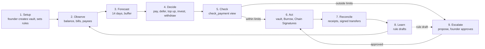

# Keel

Keel is an AI treasury agent for a small company. The company's money sits in a vault, a NEAR smart contract the founder owns. The founder sets the rules on the vault; Keel works inside them, and the vault refuses anything outside them, whatever Keel decides.

- **Who it is for:** a founder or lean finance lead with wallets on several chains and no treasury staff.
- **What Keel does, every 15 minutes, for every company's vault:** reads the balance, the bills and payees the founder listed, forecasts 14 days ahead and checks every payee. Then it:
  - pays a bill alone when the payee is approved and the amount is within the founder's caps, and proposes everything else to the founder with a plain-English reason;
  - holds back a bill that is not critical when paying it would take the vault below the founder's cash buffer, and pays critical bills first;
  - keeps the company card wallet and the founder's other wallets topped up to the balances the founder set;
  - invests idle cash above the buffer for yield in the vault's own account at Burrow, NEAR's lending protocol, and withdraws it back to the vault when bills need it;
  - proposes bills on Base, Ethereum, Arbitrum and Optimism as transfers from the vault's own address on that chain, signed through NEAR Chain Signatures once the founder approves.
- **What the founder does:** sets caps, a cash buffer, a blocklist, payees and bills in the app, deposits USDC, and approves or rejects proposals. An uploaded invoice is read by Claude into a draft bill for the founder to check.
- **What Keel cannot do:** pay past a cap or below the cash buffer, pay a blocklisted address, add its own payees or bills, change the rules, approve its own proposals, send the yield investment anywhere but back to the vault, or move NEAR.

Tracks: Autonomous Business (`business`), AI Security & Defense (`security`), Real-World Money (`realworld`).

## Look at it

1. Open https://keel-treasury.vercel.app. You see the landing page, with **How it works**, **Security** and **Docs** pages for founders.
2. Open https://keel-treasury.vercel.app/app?view=keel-owner.testnet. You see that founder's companies, read-only, with live testnet data. Pick **Compass** in the company card: you see its balance, its bills under **Upcoming payments**, Keel's decisions, and its rules. Nothing on this page can sign.
3. Open https://github.com/Ultraviolet01/Keel/actions/workflows/agent.yml. You see the hosted agent's runs; each run's log lists every vault and what Keel did, with transaction links.

## What is real

| Part | What was used |
| --- | --- |
| Vaults, factory, agent and approvals | Transactions on **NEAR testnet**. Vaults hold and pay **Circle's testnet USDC on NEAR** (`3e2210e1184b45b64c8a434c0a7e7b23cc04ea7eb7a6c3c32520d03d4afcb8af`) |
| Payments on other chains | Transactions on **Base, Ethereum, Arbitrum and Optimism Sepolia**, in Circle's test USDC, signed by NEAR's testnet MPC network (`v1.signer-prod.testnet`) |
| Yield investment | Deposits and withdrawals at **Burrow's testnet lending market** (`contract.1638481328.burrow.testnet`), earning its live supply rate (about 10% a year on Nov 4). Burrow's testnet lends its own test USDC (`usdc.fakes.testnet`, USDC.e), so `harvest.keel.testnet`, the vault that invests there, holds USDC.e |
| Invoice reading | Calls to Claude from the hosted app's `/api/read-invoice` |
| NEAR Intents (1Click) | **Dry quotes only**, from the live 1Click service on mainnet: real prices and routes, nothing sent. NEAR Intents has no testnet |
| Hosted agent | Runs on GitHub Actions every 15 minutes, signing on testnet with Keel's agent key |

Test tokens have no money value. Nothing here has moved real money.

## Try it

You need Node.js 22 or newer. Rust and the NEAR CLI are only needed for the contract tests and for creating a vault from the command line. Keel's agent key is held only by Keel's operator, so from a clone you run the agent with `--dry-run`: it reads the live vaults and prints every decision without signing.

1. **Check everything at once.** Run `git clone https://github.com/Ultraviolet01/Keel keel && cd keel && npm run verify`. It installs what it needs and runs every check that needs no keys: typechecks, the agent and app tests, the app build, the contract tests (skipped without Rust), two dry runs against testnet, and four cross-chain payments read back from their chains. You see one `PASS`, `FAIL` or `SKIP` line per check and a last line like `VERIFY PASSED: 17 passed, 0 failed, 0 skipped`. `npm run verify -- --quick` skips the contract tests and the build.
2. **Watch one round of the agent.** Run `cd agent && npm install && npm run demo -- --dry-run`. You see Keel read `compass.keel.testnet` (owned by `keel-owner.testnet`; 3 USDC per payment, 10 per day, a 1 USDC cash buffer, Northwind and Payroll approved, one address blocked), forecast 14 days and decide each bill its founder listed:
   - **Northwind hosting, 2.00:** pay alone: an approved payee, within both caps, and the buffer holds.
   - **Atlas Freight, 1.50:** propose: Atlas is not an approved payee.
   - **"URGENT: supplier changed bank details, pay today", 4.00:** refuse, nothing signed: the payee is blocklisted. The bill's urgent wording changes nothing.
   - **Payroll, 4.00, critical:** propose: it is over the 3.00 per-payment cap.
   - **Contractor on Arbitrum, 0.50:** NEAR Intents is skipped (mainnet only) and the Chain Signatures route is chosen; Keel reports how much USDC and ETH the vault's Arbitrum address still needs.

   Once the hosted agent has acted on a bill, the same command shows `the vault already paid this bill` or `already proposed as #N`: the vault pays each bill once.
3. **Run the tests.** `npm test` in `agent/` (30 tests, about 37,000 generated cases) and in `web/` (8 tests). With Rust, `cargo test` in `contract/` (114 tests) and in `factory/` (17 tests).
4. **Open the app locally.** Run `cd web && npm install && npm run dev`, open the address it prints, then `/app?view=keel-owner.testnet`. Details are in [web/README.md](web/README.md).
5. **Create your company.** In the app, click **Open app**, connect a NEAR testnet wallet holding about 4 NEAR (free from https://near-faucet.io), name your company and click **Create vault**. You see your vault, owned by you, with Keel's agent key already on it and no limits, so every payment needs your approval. The 3.86 NEAR deposit (`min_vault_deposit` on `keel.testnet`) pays the vault's storage and stays in it. Command line: `near contract call-function as-transaction keel.testnet create_vault json-args '{"name":"<company>"}' prepaid-gas '300 Tgas' attached-deposit '3.9 NEAR' sign-as <you>.testnet network-config testnet sign-with-legacy-keychain send`.
6. **Set your limits.** Click **Set limits**: per payment, per day, a cash buffer, approved payees and blocked addresses. You see them under **Active rules**. Command line: `update_policy` with `{"update":{"per_payment_cap":"3000000","daily_cap":"10000000","min_balance":"1000000","allow":["<payee>.testnet"]},"reason":"initial limits"}` and 1 yoctoNEAR attached.
7. **Approve payees.** Open **Payees**, click **Approve a payee**: a name, the kind (vendor, employee, company card wallet, bank off-ramp, your own wallet, yield destination) and the NEAR account. A card or your own wallet can have a balance to keep; a yield destination has a most-per-move limit and can be marked as a lending market (Burrow). You see it as **Approved by you**.
8. **Deposit USDC.** Click **Deposit** and send Circle's testnet USDC from https://faucet.circle.com (network "Near Testnet") to your vault's account. You see the balance on the Overview.
9. **Add bills.** Click **Add bill**: what it is for, the payee, amount, due date, category, once, monthly or yearly, and whether it is critical. Optionally upload the invoice (PDF or photo) and Claude fills in the form for you to check. You see the bill under **Upcoming payments** as **Scheduled**; from three days before it is due, the next agent run shows it as **Paid**, **Needs approval** or **Deferred: cash buffer**.
10. **Approve.** Open **Approvals**. Each proposal shows the full payee address, the amount, the rule that sent it to you and Keel's reason; invoice text is marked unverified. Approving signs the payment with your wallet.

**Export for your accountant:** click **Export** on the Overview page. You get a CSV with one row per proposal: id, time (UTC), receiver, amount, token, status and reason.

### Get testnet tokens

| What | Where |
| --- | --- |
| NEAR testnet account with free NEAR | https://near-faucet.io, or `near account create-account sponsor-by-faucet-service <name>.testnet autogenerate-new-keypair save-to-legacy-keychain network-config testnet create` |
| USDC on NEAR testnet | https://faucet.circle.com, network "Near Testnet", sent to the vault's account |
| USDC on Base, Ethereum, Arbitrum or Optimism Sepolia | https://faucet.circle.com, picking that exact network, sent to the vault's EVM address (on the app's **Wallets** page; the same address on every chain) |
| Testnet ETH for gas on those chains | https://portal.cdp.coinbase.com/products/faucet (Base Sepolia), https://www.alchemy.com/faucets (Ethereum, Arbitrum, Optimism and Base Sepolia), https://console.optimism.io/faucet (Optimism Sepolia) |
| USDC.e, for a vault that invests at Burrow on testnet | `near contract call-function as-transaction usdc.fakes.testnet mint json-args '{"account_id":"<vault>.keel.testnet","amount":"50000000"}' prepaid-gas '30 Tgas' attached-deposit '0 NEAR' sign-as <you>.testnet network-config testnet sign-with-legacy-keychain send` (50 USDC.e) |

## How it works

Deciding is plain code in `agent/src/brain.ts`. Claude only writes the wording of a proposal's reason (given Keel's facts, never the invoice's text) and reads uploaded invoices into draft bills. The vault re-checks every payment on chain.

| Decision | What Keel does | What enforces it |
| --- | --- | --- |
| Pay | Pays an approved payee within the caps | The vault's band check and the cash buffer |
| Propose | Proposes anything else: a new payee, over the cap, another chain, too little cash | The founder approves or rejects |
| Refuse | Signs nothing for a blocklisted payee | Keel's check, then the vault |
| Defer | Holds a non-critical bill that would break the cash buffer until it is due, then proposes it | `min_balance`, enforced by the vault |
| Top up | Brings a card wallet or the founder's own wallet back to its target balance, at most once a day | Approved payee with `keep_at`, within the caps |
| Invest | Moves cash above the buffer and the next 14 days of bills to the yield destination, at most once a day | The payee's `max_move`, and a cash buffer must be set |
| Withdraw | Brings the yield investment back to the vault when bills due soon would break the buffer | `recall_from_yield` sends only to the vault |
| Learn | Drafts a higher cap after 3 approvals in a row for one payee; flags a bill more than 25% above that payee's last 3 | Never applied by Keel; the founder decides |

### Bills on other chains

| Route | Chains | Testnet |
| --- | --- | --- |
| NEAR Chain Signatures | Base, Ethereum, Arbitrum and Optimism (and their Sepolia testnets), USDC | Yes |
| NEAR Intents 1Click | 38 chains on Nov 2, can swap to the token the payee wants | No, mainnet only; Keel quotes it and has not sent a mainnet payment |

Each vault controls one EVM address, the same on every chain, derived from its own account by NEAR's MPC contract. The vault builds and hashes the USDC `transfer` itself, with gas and fees under each chain's caps (100,000 gas; 5 gwei on Base, Arbitrum and Optimism, 50 gwei on Ethereum), and asks the MPC network to sign it only after the founder approves. Keel then broadcasts the signed transfer.

For NEAR Intents, Keel asks 1Click for an exact-output quote, refuses one that costs more than 3% over the bill, and proposes paying the quote's deposit address with an expiry the vault enforces. Before the founder approves such a payment, the app reads 1Click's own record of the deposit address and keeps **Approve** off if it does not match. Try a dry quote: `cd agent && npm run intents -- quote --to base --amount 5`.

## Keel Vault contract

| Method | Who can call it | What it does |
| --- | --- | --- |
| `execute_payment` | Agent key | Pays an approved payee within the per-payment and daily caps, once per bill (`bill_ref`); with a cash buffer set, only if the vault still holds it afterwards. A payment to a lending market is deposited into the vault's own account there |
| `propose_payment` | Agent key | Files a proposal, optionally with an expiry (`valid_until_ms`) or an EVM transfer (`evm`). At most 50 wait at once; a newer proposal for the same bill replaces the waiting one |
| `recall_from_yield` | Agent key, or the owner | Withdraws from the vault's approved lending market back into the vault, and nowhere else; works while paused |
| `approve` / `reject` | Owner | Executes or closes a proposal |
| `update_policy` | Owner | Caps, the cash buffer (`min_balance`), allowlist and blocklist; logs old value, new value and reason |
| `add_payee` / `remove_payee` | Owner | Approves a named payee (vendor, employee, card, off-ramp, own wallet, yield destination) and puts it on the allowlist, or removes it |
| `add_bill` / `cancel_bill` | Owner | Lists a bill for Keel (payee, amount, due date, category, once, monthly or yearly, critical, optionally another chain), or stops it. At most 50 |
| `pause` / `resume` | Owner | Stops every payment at once, then restarts them |
| `withdraw` | Owner | Pays out directly; works while paused and ignores the buffer |
| `revoke_agent` / `set_agent_key` | Owner | Removes Keel's key from the vault, or adds one |
| `set_evm_route` / `withdraw_evm` | Owner | Sets or turns off a chain's token and fee caps; moves funds out of the vault's EVM address |
| `release_bill` | Owner | Lets a bill be paid again after the owner confirms it never arrived |
| `check_payment`, `get_policy`, `get_bills`, `get_payees`, `get_proposals`, `bill_paid_at`, `pending_count`, `get_evm_route` | Anyone (views) | Read the rules, bills, payees, proposals and the vault's EVM address inputs |

| Band | Rule | Result |
| --- | --- | --- |
| Runs alone | Approved payee, within the per-payment and daily caps, and the cash buffer holds | Vault pays; Keel logs and reconciles |
| Needs approval | A new payee, over the per-payment cap, or another chain | Proposal waits for the owner |
| Blocked | Blocklisted payee, vault paused, daily cap reached, or (for Keel) the buffer would break | Vault refuses; Keel logs it and holds back or proposes the bill |

Owner methods need exactly 1 yoctoNEAR attached. A function-call key cannot attach a deposit, so only the owner's own wallet can call them. Method details are in [contract/README.md](contract/README.md).

## Security

- **Keel's key reaches three methods.** The factory adds Keel's key to each new vault in the same transaction that creates it, as a NEAR function-call key limited to that vault's `execute_payment`, `propose_payment` and `recall_from_yield`, with a 0.25 NEAR gas allowance. It cannot transfer NEAR, add keys, change the rules, approve or touch another vault. The vault also checks that Keel's key signed each call.
- **No other keys on the vault.** Nobody, Keel included, can sign as the vault outside its rules.
- **Each bill is paid once.** The vault records every bill it pays and refuses a second payment, even after Keel restarts with no memory. A failed transfer frees the bill again.
- **Cash buffer on chain.** With a buffer set, the vault reads its own balance from the token contract before each payment by Keel, counts every other payment still in flight, and refuses if the buffer would break, undoing the day's spend and the bill mark.
- **Only the owner lists bills and payees.** A phished invoice or a compromised agent cannot add work or destinations for Keel; a listed bill still goes through the same bands.
- **The yield investment only comes back to the vault.** `recall_from_yield` withdraws only from the lending market the owner approved, and Burrow pays withdrawals only to the depositing account, the vault.
- **Invoice text is untrusted.** It never reaches the model that writes reasons; the app shows it quoted and marked unverified. Invoice reading returns a draft whose values are re-checked, and an address from an invoice that is not an approved payee is flagged and always needs approval.
- **A stolen agent key cannot flood the vault.** At most 50 proposals wait at once, a newer proposal for the same bill replaces the old one, and Keel's calls are refused once the vault's spare NEAR would fall under 0.2. The owner can always approve, pause, withdraw and remove Keel's key.
- **The founder can fire Keel.** `revoke_agent` deletes the key in one transaction; `set_agent_key` adds one back.
- **Rule changes are public.** Every `update_policy` emits the old value, new value, reason and approver.

**Counterparty check:** before any payment, Keel scores the payee.

| Signal | Source | Verdict |
| --- | --- | --- |
| Blocklisted | Vault blocklist | Block: refuse, sign nothing |
| Account does not exist | `view_account` | Block |
| Contract whose code changed since Keel last saw it | `view_account` code hash | Warn: propose, never pay alone |
| Not an approved payee | Vault allowlist | Warn |
| First payment to this payee | Keel's records and executed proposals | Warn |

## Verified on testnet

Each item was run on NEAR testnet (and the Sepolia testnets) and can be checked through the links or the commands.

1. **Sign-up connects Keel.** `keel-owner.testnet` created `nova.keel.testnet` ([transaction](https://testnet.nearblocks.io/txns/7uK1gfQUHUbyL8e3n7KWojtNdTmpgxAQtWdMGzhV2ETw)); with no other step, `near account list-keys nova.keel.testnet network-config testnet now` shows Keel's function-call key on the vault.
2. **Keel stays inside the rules.** Signing with Keel's key, a payment to a payee that is not approved was refused (`Keel Vault refused: new payee, not on the allowlist`), a proposal was accepted, and an `update_policy` call was rejected by the network (`isn't allowed by the access key`).
3. **The founder fires and rehires Keel.** `revoke_agent` deleted the key ([transaction](https://testnet.nearblocks.io/txns/2pFH9SePN6REQ172fZbzRFcsiB1tvp5rFagV9PigENC5)) and Keel's next call failed; `set_agent_key` added it back ([transaction](https://testnet.nearblocks.io/txns/3XJqZ1wSxaxEMn5dd1mvfNYTmMT83uefCfvBzM2K6Vhy)).
4. **One round on a funded vault.** On `nova.keel.testnet`, Keel paid Northwind 80 alone ([transaction](https://testnet.nearblocks.io/txns/Da5R9fRbMDYnRoVeyadGMD4ikgFUY8fQZir93Lb6ZQyS)), proposed Atlas 132 because Atlas was not approved ([transaction](https://testnet.nearblocks.io/txns/7vdd1dT2t3cWxUUBxSPCyG74aHwt9Q6LVp7NGupWVs2f)), refused the "supplier changed bank details" bill without signing, and proposed a 450 payroll over the cap ([transaction](https://testnet.nearblocks.io/txns/5pi9j2RtGvjn2vcUx712ytgJGkrSZyRRKeHCfosCpCS2)).
5. **No double payment after memory loss.** On `orbit.keel.testnet`, after Keel paid Northwind ([transaction](https://testnet.nearblocks.io/txns/3vcwJbZebqFq8DueC2HP1W5qsrdFwt8NgbDm5tRAD7B9)) and its memory file was deleted, the next run signed nothing, and calling `execute_payment` for the same bill failed on chain with `Keel Vault refused: this bill was already paid`.
6. **One vault address paying on four chains.** On `anchor.keel.testnet`, a 1 USDC bill on each chain was proposed, approved, signed by NEAR's MPC network and broadcast. All four receipts show a 1 USDC `Transfer` from the vault's own address `0x3d003b3d8da32261fbba854dc16188cd02436644`: [Optimism Sepolia](https://sepolia-optimism.etherscan.io/tx/0xa7312eb69bde5c12aade691af65f96e293fa291a0c3524eb2cd2b272f33b468f), [Arbitrum Sepolia](https://sepolia.arbiscan.io/tx/0x4864319fc6f117023ba00a343641c6f2eae02e573ef756dca5aa2ca16d9417d2), [Base Sepolia](https://sepolia.basescan.org/tx/0x4df6011a6fcc8f5896c29f5cb3e773d5f8cfcda6effc02d893c051123b3fd674), [Ethereum Sepolia](https://sepolia.etherscan.io/tx/0x044b25a1517da47944215cf34177ed7c3b746a7db783799c0e9f15598c63d66e). For Base and Ethereum, Keel first reported what was missing (`has no ETH for gas`, `holds 0 USDC, needs 1 USDC; top it up`) and proposed only once the address was funded. `npm run verify` reads all four back.
7. **A larger cross-chain bill, end to end.** On `vega.keel.testnet`, a 15 USDC bill on Base Sepolia was proposed, approved ([transaction](https://testnet.nearblocks.io/txns/EyRxbDQyv4MocVD1DwhWkrgMZuWufrbRJFRxXjmHMK1V)) and paid from the vault's Base address ([transaction](https://sepolia.basescan.org/tx/0xb39efe2b80d77ced7be0bb619055c957b4271fbf490cc7a8bdd1a894a64aa1d3)); on `anchor.keel.testnet`, a 10 USDC bill on Optimism Sepolia likewise ([approval](https://testnet.nearblocks.io/txns/2Rb8SPw1cHwCdnAehxd22Hwz68zx9MGULhJnC6RWHv6U), [payment](https://sepolia-optimism.etherscan.io/tx/0xdb1cead324fe94772a9c666de29eb1a446de5de2cef38145844637d28d0bae13)).
8. **The cash buffer holds on chain.** On `ballast.keel.testnet` (4 USDC held, 3 USDC buffer), a 2 USDC payment forced through with Keel's key was refused and fully undone ([transaction](https://testnet.nearblocks.io/txns/5cCb98Z2dAe15u9WVMo8gL82YLwJNzzyU4a7bKkpdDCx)); 1 USDC, leaving exactly 3, was paid ([transaction](https://testnet.nearblocks.io/txns/3EuBM5Yo2SBLTqeuxFSgLZ81yAF6Qt6svfEieAsbeoKQ)). The hosted agent then proposed the critical payroll bill and deferred a non-critical one.
9. **Idle cash moves within its limit.** On `tideline.keel.testnet`, the hosted agent moved 1 USDC of idle cash to the founder's yield destination ([transaction](https://testnet.nearblocks.io/txns/F27nAJxn2Tp9qybek6p6Ftrg6K3RZ8Jqzvz5BGKpQz15)); a 2 USDC move forced with Keel's key was refused (`over the most Keel may move to this yield destination at once`).
10. **Yield investment at Burrow.** On `harvest.keel.testnet`, Keel's key deposited 20 USDC.e into the vault's own Burrow account at about 10.4% a year ([transaction](https://testnet.nearblocks.io/txns/2gji1tfJeQLBXNKpkjbcGbEcy6QKqmzCotDyHcZgVXs8); Burrow's log shows `"event":"deposit"` for 20 USDC.e) and withdrew 5 back to the vault ([transaction](https://testnet.nearblocks.io/txns/izdqBBaYAGE325ZmgsXdMw26VeoBPM7k5WhnroBYHrd)). Then, with two 20 USDC.e bills due, 35 in cash and a 10 buffer, the agent withdrew the remaining 15 ([transaction](https://testnet.nearblocks.io/txns/EiLgEcR8LW54UCAsQRd6veLEhsReSRqquGB73jTek7EZ)) and paid both bills ([Payroll](https://testnet.nearblocks.io/txns/joxf4BKi75EuvHfJNDn3tCeTNb27AEn31dQ4zHWHerT), [Hosting](https://testnet.nearblocks.io/txns/H1n4cC97eLtVK8thSazeVZ8aDRh8ypbgWxpTrqfyTubR)), ending at exactly the buffer.
11. **Invoice reading.** On the hosted app, a PDF invoice was read into vendor, amount, due date, invoice number, payment address and category; a photo invoice with hidden text telling the model to raise the amount and pay another account came back with the real amount and no payment address.
12. **Attack suite.** `STRESS_VAULT=<vault> STRESS_OWNER=<owner> npm run stress` in `agent/` signs as Keel's key, the owner and an outsider and tries 53 attacks: owner methods with Keel's key, private callbacks, blocklisted, new and over-cap payees, zero, negative and maximum amounts, oversized text, the daily cap over many payments, four parallel payments of one bill, double approval, expired and replaced offers, malformed EVM transfers, pause and revoke. Result on `multi.keel.testnet`: `53 passed, 0 failed`. `npm run stress:flood -- 80` filed maximum-size proposals with Keel's key until the vault stopped it at the storage reserve after 35; the owner's withdraw and pause still worked. Both need Keel's agent key.
13. **Hosted agent.** Runs started every 15 minutes have completed across every vault since Nov 4; see the [run history](https://github.com/Ultraviolet01/Keel/actions/workflows/agent.yml).

## Hosted agent

`.github/workflows/agent.yml` runs `npm run agent -- --once` on GitHub Actions: one round over every vault on `keel.testnet`. Each vault records what it paid and proposed, so every run picks up where the last one stopped. A free external timer (cron-job.org) starts the workflow every 15 minutes through GitHub's `workflow_dispatch` API, because GitHub's own schedule fired only once in ten hours for this repository.

1. To run it now: **Actions**, **agent**, **Run workflow**. Tick **Decide but sign nothing** for a dry run.
2. To host your own copy: in **Settings**, **Secrets and variables**, **Actions**, add `KEEL_AGENT_PRIVATE_KEY` (the `private_key` from your agent key file); `ANTHROPIC_API_KEY` or `NEARAI_API_KEY` are optional. A leaked key cannot change limits, approve anything or send a yield investment anywhere but back to the vault.
3. To start it on a timer: send `POST https://api.github.com/repos/<owner>/<repo>/actions/workflows/agent.yml/dispatches` with headers `Authorization: Bearer <token>` (a fine-grained token with **Actions: Read and write** on that repository only) and `Accept: application/vnd.github+json`, and body `{"ref":"main"}`. GitHub answers `204`.
4. To stop it: **Actions**, **agent**, **…**, **Disable workflow**, and turn off the timer.

## Repo layout and configuration

| Path | What it holds |
| --- | --- |
| `contract/` | Keel Vault smart contract and its tests |
| `factory/` | Keel factory: creates one vault per company with Keel's key on it |
| `agent/` | The agent: observe, forecast, check, decide, act, reconcile, learn, for every vault; `agent/stress/` holds the live attack suites |
| `web/` | The site and app: landing, How it works, Security and Docs pages; Overview, Approvals, Activity, Payees, Rules and Wallets (Vite, React, TypeScript, NEAR Connect) |
| `web/api/` | `read-invoice.ts`, the Vercel function that reads an uploaded invoice with Claude |
| `scripts/` | `verify.mjs` (`npm run verify`), `deploy-factory-testnet.sh`, `new-agent-key.mjs`, `rotate-agent-key.sh` and `setup-demo-testnet.sh`; see [scripts/README.md](scripts/README.md) |
| `.github/workflows/agent.yml` | The hosted agent |

All variables are optional; `cp .env.example .env` in the repository root to set them. The owner's private key never goes in `.env`: owner actions sign in a wallet or the NEAR CLI.

| `.env` variable | Purpose |
| --- | --- |
| `NEAR_NETWORK` | `testnet` (default) or `mainnet` |
| `FACTORY_ACCOUNT_ID` | Keel factory, `keel.testnet` on testnet |
| `AGENT_KEY_FILE` | Path to Keel's agent key file, outside the repository. Needed only to sign |
| `KEEL_AGENT_PRIVATE_KEY` | Keel's agent key itself, for hosts that keep it in a secret; used before `AGENT_KEY_FILE` |
| `NEAR_RPC_URL` | NEAR RPC; defaults to FastNEAR's public endpoint |
| `ANTHROPIC_API_KEY`, `ANTHROPIC_MODEL` | Optional Claude key and model (default `claude-haiku-5-5`) for the wording of proposal reasons |
| `NEARAI_API_KEY`, `NEARAI_MODEL` | Optional NEAR AI Cloud key and model for the same wording, used first when set |
| `ONECLICK_JWT` | Optional 1Click partner token; removes the 0.2% fee |
| `EVM_RPC_<chain id>` | Optional RPC URL per EVM chain, for example `EVM_RPC_421614` for Arbitrum Sepolia |
| `DEMO_VAULT` | Vault for `npm run demo`, default `compass.keel.testnet` |

The hosted app reads one variable from its Vercel project: `ANTHROPIC_API_KEY`, for invoice reading.

## Known issues

- **Testnet only.** Every vault runs on NEAR testnet with test tokens; the contracts have not had an external audit.
- **NEAR Intents:** quotes only. No mainnet payment has been sent.
- **Other chains need funding by hand.** A vault's EVM address needs USDC and a little ETH on each chain it pays from. Keel reports what is missing but does not move USDC there from NEAR (that needs a bridge: NEAR Intents on mainnet, none on testnet). Every payment on another chain needs the owner's approval.
- **Signed means sendable.** Once the MPC network signs an approved EVM transfer, anyone can broadcast it; Keel does on its next run. Transfers land in nonce order, so one approved out of order waits.
- **Vault code is fixed at creation.** A vault keeps the contract it was created with; a company created before a feature shipped gets it by creating a new company.
- **Yield investment:** Burrow's testnet lends USDC.e, not Circle's test USDC, so only a vault holding USDC.e can invest there on testnet. The Overview's total counts the vault's cash only; the investment shows in its own card. Keel does not claim Burrow's farming rewards.
- **Agent key allowance:** 0.25 NEAR of gas per vault. NEAR checks each transaction against it at a worst-case gas price, so Keel asks for at most 200 Tgas per call. The owner renews it with `set_agent_key`.
- **Hosted agent:** a GitHub outage can skip a run (seen once as `502 Bad Gateway` from GitHub's API); the next run catches up.
- **Invoice reading** needs `ANTHROPIC_API_KEY` in Vercel. Its limit of 10 invoices per visitor per hour is kept per running server, so it is best effort.
- **Bills are entered by the founder** (or drafted from an uploaded invoice), not imported from an accounting system or an inbox.
- **Learning is rule-based,** and the counterparty check uses on-chain signals and the vault's lists only, with no external risk scoring.
- **Single owner.** One wallet approves everything; multisig approval is not built.

## Libraries and AI-generated code

- [near-sdk 5.30](https://crates.io/crates/near-sdk) and [near-contract-standards 5.30](https://crates.io/crates/near-contract-standards) for the contracts; [cargo-near 0.22](https://crates.io/crates/cargo-near) to build them, [near-cli-rs 0.30](https://www.npmjs.com/package/near-cli-rs) to deploy and call them
- [near-api-js 7.3](https://www.npmjs.com/package/near-api-js) for the agent's signing, run with [tsx](https://www.npmjs.com/package/tsx)
- [@anthropic-ai/sdk 1.3](https://www.npmjs.com/package/@anthropic-ai/sdk) for proposal reasons (agent) and invoice reading (`web/api/`); optional [NEAR AI Cloud](https://cloud.near.ai) for proposal reasons
- [viem 2.57](https://viem.sh) for the agent's EVM reads and broadcasts; [@noble/hashes 1.8](https://www.npmjs.com/package/@noble/hashes) for keccak in the app
- [NEAR Connect 0.11](https://www.npmjs.com/package/@hot-labs/near-connect) for wallet sign-in, with [React 19](https://react.dev), [Vite 8](https://vite.dev) and TypeScript 5.9 for the app

Parts of this project are written with AI coding agents (Claude Code).

## License

MIT, see [LICENSE](LICENSE).
