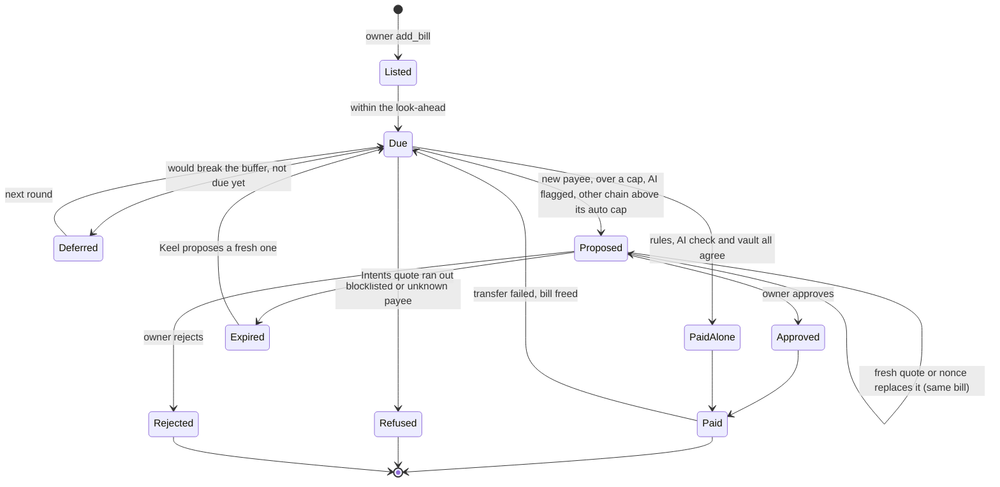

# Keel

Keel is an AI treasury agent for companies of any size, from a solo founder to a team run by a multisig. The company's money sits in a vault, a NEAR smart contract owned by the founder or, optionally, by the team's multisig. The owner sets the rules; Keel pays bills, protects the cash, tops up wallets and puts idle cash to work inside them, and the vault refuses anything outside them, whatever Keel decides.

Tracks: Autonomous Business (`business`), AI Security & Defense (`security`), Real-World Money (`realworld`).

## The problem

A company holds stablecoins in wallets on several chains, and running that treasury by hand does not scale: someone has to pay every bill, watch every balance and move every idle dollar. So bills get paid late, idle cash earns nothing, and handing an AI agent a wallet key would let it spend everything. Keel lets an agent do the treasury work while a contract the company owns decides what it may do.

## What NEAR does here

- **The Keel Vault contract** holds the company's USDC and checks every payment against the founder's caps (the daily one a rolling 24 hours), cash buffer, payees and blocklist. Every payment Keel makes must name a bill the founder listed, and match its payee and amount ([`check_agent_ref`](contract/src/lib.rs#L1504)), so even a stolen agent key can only pay the founder's own bills. A vault's code can never be changed after it is created: there is no upgrade path, for Keel or anyone.
- **A function-call access key** is Keel's only key: it reaches three vault methods (pay, propose, withdraw the yield investment back to the vault) and nothing else.
- **NEAR Chain Signatures** let the vault sign USDC payments on Base, Ethereum, Arbitrum and Optimism from its own address: routine bills inside the founder's per-chain auto cap on their own, the rest after the founder approves.
- **Rhea Finance** NEAR's lending protocol, holds the yield investment in the vault's own account.
- **A Sputnik DAO multisig** (the contracts behind Trezu treasuries) can own a vault instead of one wallet, optionally; every owner action then becomes a proposal the members vote on.
- **NEAR AI Cloud** reviews each payment before Keel makes it alone, and can only make Keel more careful: it turns a payment into a proposal or a refusal (a lookalike payee, an odd amount, a suspicious invoice), never the reverse. It also writes the reason on each proposal. **NEAR Intents** 1Click quotes cross-chain moves on mainnet.

## Lifecycle

### A company

1. **Create.** The founder signs `create_vault` on the factory `keel.testnet` with about 4 NEAR. The vault is deployed with fixed code (it can never be upgraded) and Keel's key is added in the same transaction.
2. **Set the rules.** Caps per payment and per rolling 24 hours, a cash buffer, approved payees, a blocklist, and per-chain auto caps for other chains.
3. **List bills.** One-off, monthly or yearly, typed in or imported from invoice PDFs. Only the owner can list a bill; Keel can only pay what is listed.
4. **Fund.** Deposit USDC into the vault (and into its EVM address for bills on other chains).
5. **Keel runs.** Every 15 minutes the hosted agent observes, forecasts, decides, asks the AI check, acts and reconciles; see [docs/HOW-IT-WORKS.md](docs/HOW-IT-WORKS.md).
6. **The owner decides what Keel may not.** Approve or reject proposals under **Approvals**; email alerts say when something waits.
7. **Optionally hand over to a team.** Offer the vault to a Sputnik DAO multisig; it takes over once the members vote to accept.
8. **Stay in control.** Pause, withdraw, or fire Keel (`revoke_agent`) at any time; `set_agent_key` hires it back.

### A bill

| Step | Who or what decides | Where it is enforced |
| --- | --- | --- |
| Listed | The owner only | `add_bill` is an owner method |
| Paid alone | Keel's rules, then the AI check (can only say no), then the vault | `execute_payment`: bill, payee, amount, caps, buffer ([`check_agent_ref`](contract/src/lib.rs#L1504)) |
| Proposed | Keel files it; the owner decides | `propose_payment` (same bill checks), `approve` / `reject` |
| Paid on another chain | Signed by NEAR's MPC network for the vault, broadcast by Keel | `check_evm` and the route's caps; proposal status `signing` then `signed` |
| Paid once | The vault remembers every bill it paid | `bill_paid_at`; a failed transfer frees the bill again |
| Repeats | A monthly or yearly bill comes back for its next period only | Periods checked by the vault: from the first due date to next month or year |

## Built during NEAR HACKATHON

All code in this repository was written during the hackathon: the first commit is 2026-11-02, and no earlier project of ours is reused. Outside libraries are listed under [Libraries and AI-generated code](#libraries-and-ai-generated-code). The hosted app stays up through judging, until at least 2026-11-25.

## Look at it

1. Open https://keel-treasury.vercel.app. You see the landing page and the **How it works**, **Security** and **Docs** pages.
2. Open https://keel-treasury.vercel.app/app?view=keel-founder5-39175.testnet. You see the demo company **Lantern** read-only with live testnet data: balance chart, bills, Keel's decisions and the rules. Under **Approvals**, proposal #19 is a lookalike payee (`northwlnd-keel.testnet`) that NEAR AI held for the owner instead of paying; under **Wallets**, the vault's address on four other chains, each paying bills alone up to its auto cap.
3. On the same page, click **Export**. You get an Excel workbook with five sheets: **Summary** (balances, counts, rules), **Activity** (every decision, who made it and why), **Payments** (the bill schedule and each bill's status), **Ledger** (every transfer, labelled from the transaction that made it, with links) and **Wallets** (the vault on NEAR, the yield investment and the vault's address on each other chain).
4. Open https://keel-treasury.vercel.app/app?view=keelteam85369.sputnikv2.testnet, pick **Deck85369** in the company card, then open **Rules**. You see a company owned by a 2-member Sputnik DAO multisig: its members and what each may do, the votes a change needs, and any open proposals with their exact calls and arguments.
5. Open https://github.com/Ultraviolet01/Keel/actions/workflows/agent.yml. You see the hosted agent's runs, every 15 minutes; each log lists what Keel did in every vault, with transaction links.

## Try it

You need Node.js 22 or newer (Rust only for the contract tests).

1. Run `git clone https://github.com/Ultraviolet01/Keel keel && cd keel && npm run verify`. You see one `PASS`, `FAIL` or `SKIP` line per check (typechecks, agent and app tests, app build, contract tests, two dry runs on testnet, four cross-chain payments read back from their chains) and a last line like `VERIFY PASSED: 17 passed, 0 failed, 0 skipped`.
2. Run `cd agent && npm install && npm run demo -- --dry-run`. You see Keel read `lantern.keel.testnet` and decide each bill its founder listed, signing nothing: pay Northwind alone (approved payee, inside the caps), propose Atlas (not an approved payee), refuse the "supplier changed bank details" bill (blocklisted), and propose Payroll (over the per-payment cap). Bills the hosted agent already handled show as `already paid` or `already proposed`.
3. Run `cd ../web && npm install && npm run dev` and open the address it prints. You see the same site as above, running locally.

## Testnet tokens

Everything runs on NEAR testnet with free test tokens.

| You need | Get it from |
| --- | --- |
| NEAR for your wallet (about 4 to create a company, about 6 more for a team multisig) | https://near-faucet.io |
| USDC on NEAR testnet, to deposit into your vault | https://faucet.circle.com, network **NEAR Testnet**, sent to your vault's account (shown under **Deposit**) |
| USDC on Base, Ethereum, Arbitrum or Optimism Sepolia, for bills on those chains | https://faucet.circle.com, that network, sent to your vault's EVM address (under **Wallets**) |
| ETH for gas on those chains | https://www.alchemy.com/faucets or https://portal.cdp.coinbase.com/products/faucet |
| USDC.e, to try the yield investment at Rhea lending | Anyone can mint it: `near contract call-function as-transaction usdc.fakes.testnet mint json-args '{"account_id":"<vault>.keel.testnet","amount":"50000000"}' prepaid-gas '30 Tgas' attached-deposit '0 NEAR' sign-as <you>.testnet network-config testnet sign-with-legacy-keychain send` (50 USDC.e) |

To create your own company, set limits, approve payees, deposit and add or import bills, follow [docs/SETUP.md](docs/SETUP.md).

## What is real

| Part | What was used |
| --- | --- |
| Vaults, factory, agent, approvals | NEAR testnet, paying Circle's testnet USDC |
| Payments on other chains | Base, Ethereum, Arbitrum and Optimism Sepolia, signed by NEAR's testnet MPC network |
| Yield investment | Rhea lending's testnet market, `contract.1638481328.burrow.testnet` (about 10% a year on Nov 4), in Rhea's test USDC (USDC.e) |
| Invoice reading | Claude, called from the hosted app |
| Multisig owner | A 2-member Sputnik DAO on testnet (`sputnikv2.testnet`), every change needing both votes; Trezu's own app was not tested on testnet |
| Email notifications | Gmail, sent from a Vercel Function after each agent round; addresses in a private Vercel Blob store, sign-up proved by a NEAR wallet-signed message (NEP-413) |
| Excel report | Built in the browser with ExcelJS from live chain data: nearblocks' index for transfers, FastNEAR's archive node for each transaction |
| NEAR Intents | Live mainnet 1Click quotes in dry mode (`dry: true`), the method the hackathon approved because Intents has no testnet (`agent/src/loop.ts` `viaIntents`; deposit check before approval in `web/src/intents.ts`) |

Test tokens have no money value. Nothing here has moved real money.

## Learn more

| Document | What it covers |
| --- | --- |
| [docs/HOW-IT-WORKS.md](docs/HOW-IT-WORKS.md) | The agent's loop, every decision it makes, and how bills on other chains are paid |
| [docs/CONTRACT.md](docs/CONTRACT.md) | The vault's methods, who can call each, and the payment bands |
| [docs/SECURITY.md](docs/SECURITY.md) | What protects the money, each claim with the line of code that enforces it: Keel's key, bills behind every payment, the rolling cap, the cash buffer, the AI check, the counterparty check, the multisig hand-over |
| [docs/VERIFIED.md](docs/VERIFIED.md) | 18 checks run on testnet, each with transaction links |
| [docs/SETUP.md](docs/SETUP.md) | Creating a company, handing it to a multisig, the Excel report, email notifications, testnet tokens, the hosted agent, repository layout, configuration and the full list of known issues |

## Known issues

- NEAR Intents has no testnet, so Keel exercises it with dry quotes from the live mainnet service, the approved method (Q-007): `viaIntents` in `agent/src/loop.ts` asks 1Click for an exact-output quote with `dry` set, and `checkDeposit` in `web/src/intents.ts` checks a deposit address with 1Click before the owner approves. No mainnet payment has been sent.
- A vault's address on another chain must be funded by hand (USDC and a little ETH). A payment there needs the owner's approval unless it is inside that chain's auto cap, to a 0x payee on the allowlist, and inside the vault's caps: approvals are only needed outside the owner's limits, on purpose.
- On testnet, Rhea lending lends USDC.e only, so only a vault holding USDC.e can invest there.
- Multisig ownership works with Sputnik DAO multisigs only, and a handed-over vault cannot go back to one wallet without the multisig voting for it. Keel finds a member's teams by reading every vault's owner, which suits testnet's size, not thousands of vaults.
- The Excel report's Ledger lists the latest 200 transfers from nearblocks' index, which does not index Rhea's test USDC.e.

The full list is in [docs/SETUP.md](docs/SETUP.md#known-issues).

## Libraries and AI-generated code

- [near-sdk 5.30](https://crates.io/crates/near-sdk) and [near-contract-standards 5.30](https://crates.io/crates/near-contract-standards) for the contracts; [cargo-near 0.22](https://crates.io/crates/cargo-near) to build them, [near-cli-rs 0.30](https://www.npmjs.com/package/near-cli-rs) to deploy and call them
- [near-api-js 7.3](https://www.npmjs.com/package/near-api-js) for the agent's signing, run with [tsx](https://www.npmjs.com/package/tsx)
- [@anthropic-ai/sdk 1.3](https://www.npmjs.com/package/@anthropic-ai/sdk) for proposal reasons (agent) and invoice reading (`web/api/`); optional [NEAR AI Cloud](https://cloud.near.ai) for proposal reasons
- [nodemailer 10.4](https://www.npmjs.com/package/nodemailer) and [@vercel/blob 2.8](https://www.npmjs.com/package/@vercel/blob) for email notifications; [@noble/curves 1.9](https://www.npmjs.com/package/@noble/curves) and [@scure/base 1.2](https://www.npmjs.com/package/@scure/base) to check wallet-signed messages
- [ExcelJS 4.4](https://www.npmjs.com/package/exceljs) for the Excel treasury report, built in the browser
- [viem 2.57](https://viem.sh) for the agent's EVM reads and broadcasts; [@noble/hashes 1.8](https://www.npmjs.com/package/@noble/hashes) for keccak in the app
- [NEAR Connect 0.11](https://www.npmjs.com/package/@hot-labs/near-connect) for wallet sign-in, with [React 19](https://react.dev), [Vite 8](https://vite.dev) and TypeScript 5.9 for the app

Parts of this project are written with AI coding agents (Claude Code).

## License

MIT, see [LICENSE](LICENSE).
