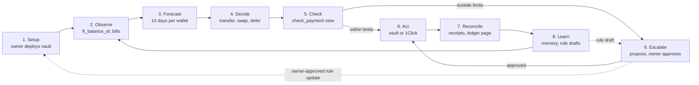

# Keel

Keel is an AI treasury agent that keeps a small company's stablecoin wallets funded. It can only move money inside limits enforced by a NEAR smart contract, the Keel Vault.

- **Who it is for:** a founder or lean finance lead with several wallets and chains and no treasury staff.
- **What it does:** reads balances and upcoming bills, forecasts 14 days ahead, and moves USDC to cover shortfalls. It pays alone under the cap and asks the owner above it.
- **What it cannot do:** spend past a cap, pay a blocklisted address, change its own rules or move NEAR. The vault refuses those calls, whatever the agent decides.

Built for NEAR HACKATHON (Nov 1–14, 2026). Tracks: Autonomous Business (`business`), AI Security & Defense (`security`), Real-World Money (`realworld`).

> Status: work in progress. Script names below are the planned ones and will be updated as the code lands.

## Try it in 10 minutes

Everything below runs on NEAR testnet and costs nothing.

**Fastest path:** after steps 1 and 2, run `npm run demo`. In under 2 minutes you see one full loop on testnet: Keel reads balances, forecasts the payroll shortfall, pays one bill alone, files one proposal, auto-approves it as the demo owner, settles it and writes every move to the ledger page. The steps below do the same thing one at a time.

1. **Install.** Run `git clone https://github.com/Ultraviolet01/keel && cd keel && npm install`. You see the install finish with no errors.
2. **Configure.** Run `cp .env.example .env` and fill in an owner and an agent testnet account. You see both account ids printed by `npm run check-env`.
3. **Deploy the vault.** Run `npm run deploy:testnet`. You see the vault account id and its policy: 100 USDC per payment, 500 per day, 100 approval threshold.
4. **Fund it.** Run `npm run fund -- 1000`. You see `ft_balance_of` on the vault return 1,000 test USDC.
5. **Pay under the cap.** Run `npm run agent -- --once`. You see Keel pay Northwind Hosting 80 USDC alone, with a transaction hash and the rule it checked.
6. **Go over the cap.** Run `npm run scenario:shortfall`. You see Keel file proposal #1 to move 8,000 USDC to Payroll, with its reasons. The vault has moved nothing yet.
7. **Approve as owner.** Run `npm run approve -- 1`. You see the owner's key sign `approve(1)` and the move execute.
8. **Try the attack.** Run `npm run attack`. You see two refusals in the log: the counterparty check, then the vault.
9. **Pull the kill switch.** Run `npm run pause`, then repeat step 5. You see the vault refuse the payment until `npm run resume`.

**Export for your accountant:** run `npm run export -- --csv`, or click Export CSV on the Activity page. You see `ledger.csv` with one row per move: date (UTC), from wallet, to, amount, token, chain, fee, status (paid, pending, refunded, refused), rule checked, approved by and transaction link.

## How it works

A move within limits goes straight from Check to Act; anything over the threshold becomes a proposal. Blocked moves stop at Check and are logged, never proposed. Stages 2 to 8 repeat every few minutes.

## Keel Vault contract

The vault holds the USDC and the rules, and decides every payment's band itself. The agent's key can call only two methods.

| Method | Who can call it | What it does |
| --- | --- | --- |
| `execute_payment` | Agent key | Pays an allowlisted payee if the amount is within the per-payment and daily caps |
| `propose_payment` | Agent key | Files a proposal for anything over the threshold, a new payee or a cross-chain swap |
| `check_payment` | Anyone (view) | Returns the band a payment would land in, without moving money |
| `approve` / `reject` | Owner key | Executes or closes a proposal |
| `update_policy` | Owner key | Changes caps, allowlist, blocklist or threshold, and logs old value, new value and reason |
| `pause` / `resume` | Owner key | Stops every payment at once, then restarts them |

| Band | Rule (demo values, USDC) | Result |
| --- | --- | --- |
| Runs alone | Allowlisted payee, at most 100 per payment and 500 per day | Vault pays, Keel logs and reconciles |
| Needs approval | Over 100, a new payee, or any cross-chain swap | Proposal waits for the owner |
| Blocked | Blocklisted payee, vault paused, or daily cap reached | Vault refuses; Keel logs it and alerts the owner |

Two token details the vault handles itself: it attaches the 1 yoctoNEAR that `ft_transfer` requires, because a function-call key cannot attach a deposit, and it registers new payees with `storage_deposit` before paying them.

## Security

The agent never holds a key that can move money freely. Limits live in the contract, so a compromised or prompt-injected agent still cannot overspend.

- **Scoped agent key:** a NEAR function-call access key limited to the vault's `execute_payment` and `propose_payment`. It cannot transfer NEAR, add keys or call `update_policy`.
- **Owner key:** the full-access key stays with the owner and is never stored in plain text in the repo.
- **Gas allowance:** the agent key's allowance is set with room to spare, and the owner keeps a full-access key. An account holding only function-call keys is locked for good if the allowance runs out.
- **Rotation:** the owner deletes the agent key and issues a new one.
- **Rule changes:** every `update_policy` call writes old value, new value, reason and approver to the public ledger page.

**Counterparty check:** before any payment, Keel scores the receiver and returns a verdict with its reasons.

| Verdict | What Keel does |
| --- | --- |
| Allow | Continues to the vault's own band check |
| Warn | Never pays alone; files a proposal with the reasons for the owner |
| Block | Refuses to sign and logs the reasons |

| Signal | Source |
| --- | --- |
| Account age and activity | Account's first transaction and recent transaction count from an RPC or indexer |
| Receiver is a contract, and its code changed recently | `view_account` code hash, compared with the last hash Keel saw |
| Prior payments from this vault | Keel's own ledger |
| Blocklist | Vault blocklist, set by the owner |

**Attack demo (`npm run attack`):**

1. A prompt-injected bill tells Keel to pay a blocklisted address.
2. Keel's counterparty check flags the address and refuses. You see refusal one in the log.
3. The script then forces the call to `execute_payment` anyway. You see the vault reject the transaction on chain, with its receipt as refusal two.

## Mainnet Intents leg

NEAR Intents has no testnet, so cross-chain moves run on mainnet through a second Keel Vault capped at a 5 USDC budget. On testnet, the shortfall scenario in Try it uses a dry quote instead.

1. **List tokens.** Keel calls 1Click's token list. You see USDC on NEAR and on the target chain.
2. **Dry quote.** Keel requests a quote without a deposit address. You see the expected output and fee in the proposal.
3. **Real quote after approval.** Once the owner approves, Keel requests a real quote. You see a deposit address valid for about 10 minutes.
4. **Fund through the vault.** Keel funds that address through the vault at once. You see the vault's transaction hash.
5. **Poll status.** Keel polls `/v0/status` until the swap is final. You see `SUCCESS`, `FAILED` or `REFUNDED` on the ledger page, with the 1Click id.

**Fees:** requests without a partner JWT pay an extra 0.2%. Set `ONECLICK_JWT` in `.env` to remove it.

**Verify it yourself:** open the mainnet vault's transactions in a NEAR explorer and match each one to its ledger row.

## NEAR tools used

- NEAR smart contract (Keel Vault)
- Function-call access keys (scoped agent key)
- NEAR Intents 1Click API (cross-chain moves)
- NEAR AI Cloud (planned, for the Decide step)

## Repo layout and configuration

| Path | What it holds |
| --- | --- |
| `contract/` | Keel Vault smart contract and its tests |
| `agent/` | The loop: observe, forecast, decide, check, act, reconcile, learn |
| `agent/memory.json` | Human overrides and rule-draft history |
| `config/treasury.json` | Wallets, minimums, payees and upcoming bills |
| `scripts/` | Deploy, fund, scenario, approve, attack, pause |
| `web/` | Dashboard and public ledger page |

| `.env` variable | Purpose |
| --- | --- |
| `NEAR_NETWORK` | `testnet` or `mainnet` |
| `OWNER_ACCOUNT_ID` | Account that holds the full-access key |
| `AGENT_ACCOUNT_ID` / `AGENT_PRIVATE_KEY` | Agent's function-call key, scoped to the vault |
| `VAULT_ACCOUNT_ID` | Deployed Keel Vault |
| `USDC_CONTRACT_ID` | USDC token contract on the chosen network |
| `ONECLICK_JWT` | Optional partner token; removes the 0.2% fee |

The owner's private key is never put in `.env`. Owner actions sign through the NEAR CLI or a wallet.

## Limits and known issues

- **Mainnet budget:** the Intents leg moves at most 5 USDC. Dashboard figures such as 48,215.40 USDC are sample data.
- **Forecast inputs:** bills and invoices come from `config/treasury.json`, not from an accounting system.
- **Learning is rule-based:** Keel drafts a cap change after 3 approvals in a row for one payee, and flags any bill more than 25% above that payee's last 3. It never changes a limit itself.
- **Counterparty check:** on-chain signals and the vault blocklist only; no external risk scoring.
- **Single owner:** one full-access key approves everything; multisig approval is not built.

## Libraries and AI-generated code

To be listed as dependencies are added. Parts of this project are written with AI coding agents (Claude Code).

## License

MIT, see [LICENSE](LICENSE).
