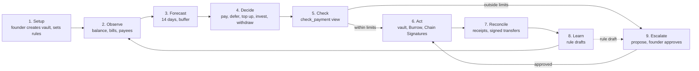

# How Keel works

[Back to the README](../README.md)

## The loop

Deciding is plain code in `agent/src/brain.ts`. Claude only writes the wording of a proposal's reason (given Keel's facts, never the invoice's text) and reads uploaded invoices into draft bills. The vault re-checks every payment on chain.

| Decision | What Keel does | What enforces it |
| --- | --- | --- |
| Pay | Pays an approved payee within the caps | The vault's band check and the cash buffer |
| Propose | Proposes anything else: a new payee, over the cap, another chain, too little cash | The founder approves or rejects |
| Refuse | Signs nothing for a blocklisted payee | Keel's check, then the vault |
| Defer | Holds a non-critical bill that would break the cash buffer until it is due, then proposes it | `min_balance`, enforced by the vault |
| Top up | Brings a card wallet or the founder's own wallet back to its target balance, at most once a day | Approved payee with `keep_at`, within the caps |
| Invest | Moves cash above the buffer and the next 14 days of bills to the yield destination, at most once a day | The payee's `max_move`, and a cash buffer must be set |
| Withdraw | Brings the yield investment back to the vault when bills due soon would break the buffer | `recall_from_yield` sends only to the vault |
| Learn | Drafts a higher cap after 3 approvals in a row for one payee; flags a bill more than 25% above that payee's last 3 | Never applied by Keel; the founder decides |

### Bills on other chains

| Route | Chains | Testnet |
| --- | --- | --- |
| NEAR Chain Signatures | Base, Ethereum, Arbitrum and Optimism (and their Sepolia testnets), USDC | Yes |
| NEAR Intents 1Click | 38 chains on Nov 2, can swap to the token the payee wants | No, mainnet only; Keel quotes it and has not sent a mainnet payment |

Each vault controls one EVM address, the same on every chain, derived from its own account by NEAR's MPC contract. The vault builds and hashes the USDC `transfer` itself, with gas and fees under each chain's caps (100,000 gas; 5 gwei on Base, Arbitrum and Optimism, 50 gwei on Ethereum), and asks the MPC network to sign it only after the founder approves. Keel then broadcasts the signed transfer.

For NEAR Intents, Keel asks 1Click for an exact-output quote, refuses one that costs more than 3% over the bill, and proposes paying the quote's deposit address with an expiry the vault enforces. Before the founder approves such a payment, the app reads 1Click's own record of the deposit address and keeps **Approve** off if it does not match. Try a dry quote: `cd agent && npm run intents -- quote --to base --amount 5`.

## Bills on other chains

| Route | Chains | Testnet |
| --- | --- | --- |
| NEAR Chain Signatures | Base, Ethereum, Arbitrum and Optimism (and their Sepolia testnets), USDC | Yes |
| NEAR Intents 1Click | 38 chains on Nov 2, can swap to the token the payee wants | No, mainnet only; Keel quotes it and has not sent a mainnet payment |

Each vault controls one EVM address, the same on every chain, derived from its own account by NEAR's MPC contract. The vault builds and hashes the USDC `transfer` itself, with gas and fees under each chain's caps (100,000 gas; 5 gwei on Base, Arbitrum and Optimism, 50 gwei on Ethereum), and asks the MPC network to sign it only after the founder approves. Keel then broadcasts the signed transfer.

For NEAR Intents, Keel asks 1Click for an exact-output quote, refuses one that costs more than 3% over the bill, and proposes paying the quote's deposit address with an expiry the vault enforces. Before the founder approves such a payment, the app reads 1Click's own record of the deposit address and keeps **Approve** off if it does not match. Try a dry quote: `cd agent && npm run intents -- quote --to base --amount 5`.
